# Render-Engine
3D Render Engine with GLFW, GLAD, GLEW & glm

## Native DX12 and OpenGL builds

The `build/dx12` branch runs the complete Planetorium and Quantum application through native DirectX 12. Run `Build-DX12.cmd Debug` or `Build-DX12.cmd Release`, then `build\dx12\Debug\bin\Render-Engine-DX12.exe` (or `Release`). The separate `build/opengl` branch preserves the OpenGL build. Both share the same scene controls and simulations.

DX12 includes experimental **Performance > NVIDIA DLSS** Quality, Balanced, Performance and DLAA modes on supported hardware, with native rendering as the default/fallback. Stable views accumulate samples; scene changes conservatively reset history. Frame Generation and Ray Reconstruction are not integrated. See [migration changes and reasons](docs/DX12_MIGRATION.md) and [DLSS scope](docs/DLSS_2026-11-12.md).

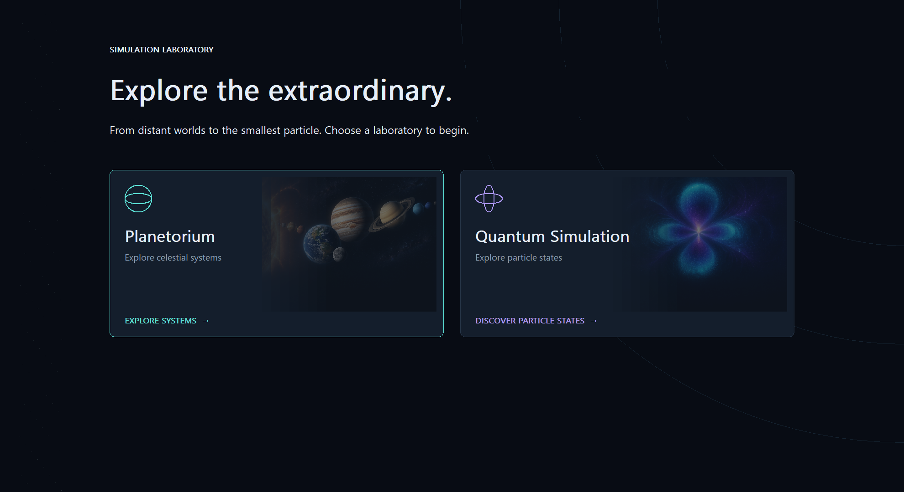

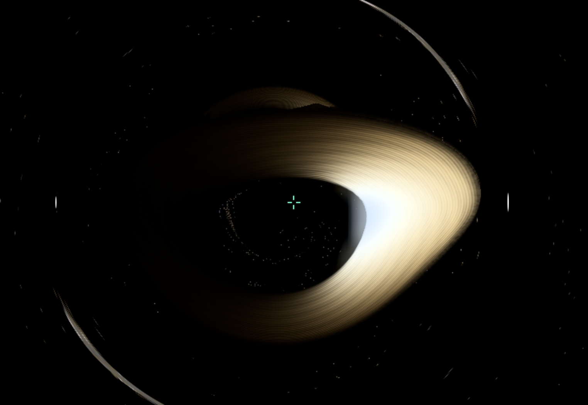

## Startup laboratories

The app opens at a main menu. Choose **Planetorium** for either **Solar System - 1:1 scale** or the **Gargantua system**. Choose **Quantum Simulation** for 38 selectable examples: infinite-well states and superpositions, harmonic-oscillator states, coherent and squeezed states, free packets, 3D hydrogen orbitals, spin states, Bell states, and numerical tunneling/scattering experiments.

**F10** returns to the main menu and pauses playback. **F2** toggles orbital trajectories, **F3** opens the object finder; **Shift+F3** searches nearby systems within a chosen radius; **F1** opens the parent/satellite overview and **Shift+F2** toggles object information, **F4** browses all star systems, and **Shift+F4** browses only the current system's planets and other bodies. **Home** shows the overview. A single browser click selects without moving or aiming the camera. Select a body in the right-hand list and press **G**, double-click it, or click **Go to selection**. In free flight, **Shift+F / T** follows its position; **Shift+R** follows position and rotation. **Shift+L** faces the selected planet, or the nearest planet when no planet is selected. Following changes show a small fading notification. Both astronomical scenes use physical AU distances, double-precision camera coordinates and camera-relative rendering. Gargantua uses 100 million solar masses; Miller has Earth's radius. Its wider 23.7 AU orbit is an illustrative Schwarzschild layout, not the film's near-horizon Kerr orbit.

The solar preset includes the Sun, eight planets, Pluto, Ceres, Vesta, Eris, a representative Halley orbit, seven moons, and 4,096 representative main-belt/Kuiper-belt markers. Planet positions use fixed J2000 Keplerian elements; surfaces are procedural illustrations. This is not a current-date ephemeris or a complete survey catalogue. Solar-system time can advance by seconds, minutes, hours, days, 30-day months, or Julian years per real second. Quantum examples use separate dimensionless time rates of 0.1x to 4x; **Ctrl+R** restarts the selected state. Their 3D view occupies the upper 80% of the workspace, with a small graph below. **Home** frames the state. Hydrogen clouds sample the true 3D orbital probability; 1D states use illustrative transverse thickness.

See [the detailed changes and reasons](docs/SIMULATION_CHANGES.md) for every changed component, equations, sources, accuracy boundaries, and validation instructions.

The interface uses a shared dark theme with clear selection/focus states, collapsible browsers and a compact Play/Pause plus Local/World clock area. [UI changes and reasons](docs/UI_POLISH_2026-11-12.md).

Click a visible star while mouse capture is released to select it, including background stars seen from the Solar System. Press **G** to visit its seeded system. Generation now varies planetary architecture, frost-line composition, moons and galactic populations. The catalogue remains a sparse 16,000-star sample, with dormant inactive systems. [Generation, picking and assertion fix](docs/STAR_GENERATION_AND_SELECTION_2026-11-12.md).

## New navigation and sky features

**F3** finds named stars, planets, moons, spacecraft, representative asteroids, galaxies, black holes and nebulae. A single click selects; **Go to** travels. **Shift+F3** searches nearby systems within a radius in light-years. **F1** browses the modeled parent/satellite hierarchy; **Back** ascends. Existing F4 side browsers remain available.

Visit **Sagittarius A***, **TON 618**, the three generated galactic cores, **Orion / M42**, **Helix**, **Crab**, or **Veil** using the finder. TON 618's disk/outflow is an original reference-inspired illustration; its uncertain mass and cosmological distance assumptions are documented. Earth clouds blend from a distant shell to a local volume. Stellar corona PNGs supplement the existing prominences, including eclipses.

[Every navigation and Milky Way change, with reasons](docs/MILKY_WAY_AND_NAVIGATION_2026-11-12.md) · [Optics, clouds, corona, magnitude and menu changes](docs/OPTICS_CLOUDS_CORONA_2026-11-12.md) · [Core/nebula sources and limits](docs/CORES_AND_NEBULAE_2026-11-12.md). [Validation results](docs/VALIDATION_2026-11-12_UNIVERSE_UI.md).

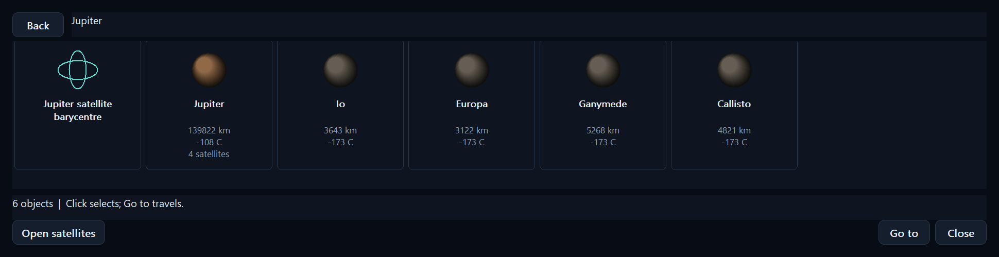

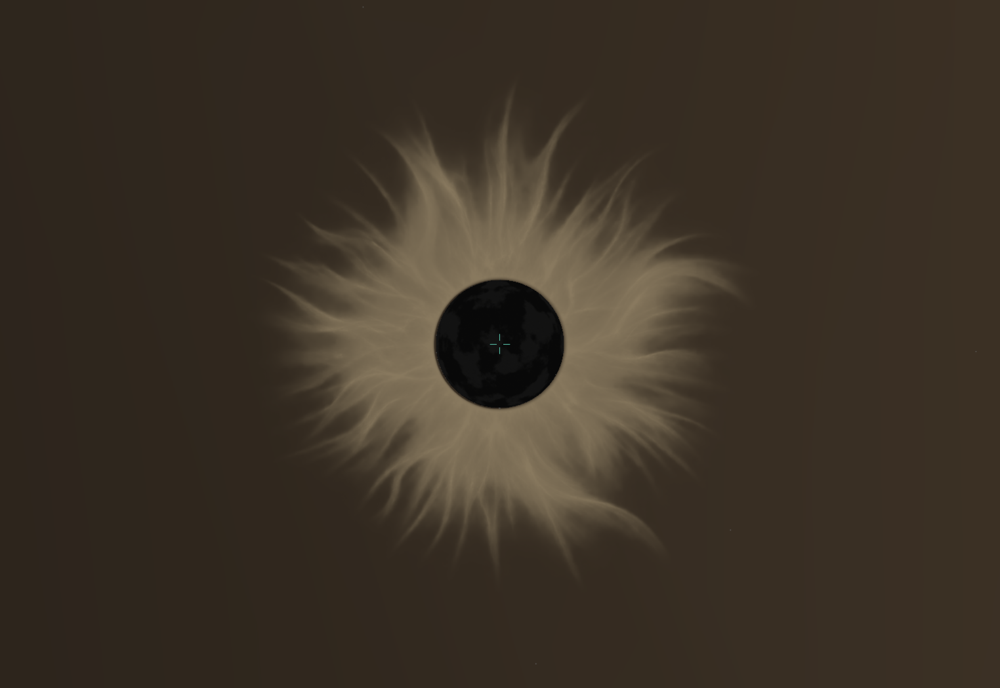

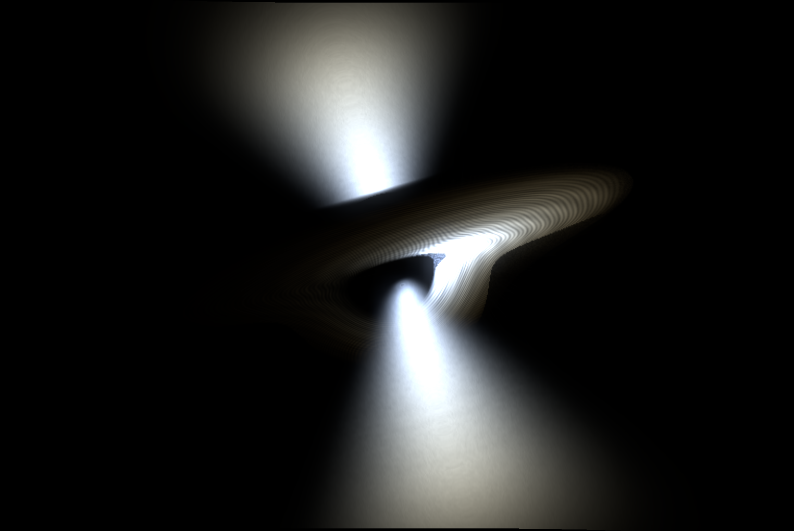

## Controls

**F5 / View > Object editor** opens a compact, modeless editor for the selected object. Select Gargantua to adjust signed spin with a live slider, a numeric value, ±0.01 buttons or Reset. Numeric edits apply with Enter/Apply; slider arrows change spin by 0.0001. The supported range is -0.98…+0.98. Horizon and disk-inner-orbit distances update alongside it. Other object types are read-only. Editing does not move the camera or restart the simulation.

- **Mouse wheel** changes flight speed gradually by 15% per notch; fractional wheel input is preserved. Scroll down to slow down. Physical flight speeds display in m/s, km/s, c, AU/s and ly/s. **Ctrl+wheel** adjusts the stellar magnitude limit by 0.20; larger values admit fainter stars.
- **Space** or **Play / Pause** starts and pauses playback. The application starts paused. The disk, ocean waves, planet rotation, and orbits share the playback clock.
- **< / >** (comma / period) selects seconds, minutes, hours, days, 30-day months or Julian years of simulated time per real second. Use day/month rates to watch the physically scaled Mann transfer. The title distinguishes camera-local elapsed time from distant/world coordinate time.
- **Black hole / Model** switches the legacy scenes and resets the view.
- **Miller flyby** moves close to the ocean planet and follows its orbital translation. You can fly around it while following.
- **Navigation > Endurance exterior** moves close to the ring-shaped spacecraft and follows it. **B** starts its prograde booster manually. **Ctrl+R** restores the initial transfer, onboard clock, docked Rangers and fuel at the current playback time.
- **F8** cycles Endurance interior, Ranger 1 interior, Ranger 2 interior and free flight. These views also have entries under **Navigation**. Mouse-look stays upright within the cabin. **Shift+L** can face a planet from the seat. Object-follow, rotation-follow, free-flight translation and roll are disabled while seated. **Home** leaves the cockpit for the overview. Interiors are original simplified geometry with open windows and instrument panels, not film-accurate scanned models.
- **Home view** or **Home** returns to a scene overview and exits planet-follow mode.
- **Right mouse button** toggles mouse-look capture. Hold **Shift + right mouse button** and move the mouse forward or backward to zoom; press the **middle mouse button** to reset the zoom. A small centre readout shows magnification and FOV, then fades after one second. **Esc** releases the cursor for the clickable Windows controls. Changing window focus also releases it.
- **WASD** moves forward, backward, and sideways. **Q / E** rolls the free-flight camera left/right; **R / F** moves up/down along its local up axis. **Left Shift** gives a temporary 5× speed boost. Grounded cameras retain their gravity-aligned upright orientation; use **L** to lift off before rolling.
- **[ / ]** or **Slower / Faster** halves or doubles flight speed. The title shows the selected speed. Camera speed operates independently of playback time.
- **F1** opens the hierarchy overview. Click to select, **Open satellites** or double-click to browse moons, and **Back** to ascend to the parent system. **Shift+F1** retains the wireframe toggle. **F9** opens the separate controls panel.
- **N / New terrain** changes legacy procedural detail. Miller remains ocean-only; Mann uses folded ice and Edmunds uses rocky desert relief. Regular generated systems retain their catalogue seeds.
- **L / Land / lift off** places the free camera above the selected/nearest solid planet's terrain or sea surface, or releases it back into flight. The physical observer envelope uses Hubble's 13.2 m length and 4.2 m diameter, with conservative 6.6 m center clearance. Movement and mouse-look remain available. The surface rotates and orbits under the observer. Miller flyby approaches near the day/night boundary; a wide lens helps show the giant black-hole shadow from the surface.
- **Left-click** with the cursor released selects a planet, star, spacecraft, or black hole. Its name appears in the title. **G / Go to selection** jumps close to its current position. Free-cam remains active after arrival.
- **H / Gravity** toggles the observer's plunge, including while world playback is paused. The selected time rate accelerates observer time. Mouse-look remains available; gravity owns translation. The observer follows a timelike Kerr geodesic and receives light in its moving local frame. Outer-horizon crossing is continuous; the model stops before the deep interior/inner horizon. See [equations and limits](docs/KERR_OBSERVER_2026-11-12.md). **Home** resets the view.
- **F6 / Photon view** toggles illustrative photon packets. Gold packets originate in the accretion disk, cyan packets originate at the spacecraft, and a green point marks a detector fixed at the camera position when enabled. Fly sideways to inspect the streams. Toggle off and on to reposition the detector. Packet motion pauses with playback.

The title distinguishes **World** playback time from **Local** observer time. The local clock applies approximate gravitational and velocity time-dilation factors. **Light age** reports how far into the spacecraft's simulated past the received image looks.

The legacy model-viewer cube rotates with playback. Dropped OBJ and FBX models keep their original transforms and open the model viewer.

`WindowManager::GetSimulationTime()` returns elapsed playback time in seconds as a `double`. A simulation scene can use this value to animate its state or pass it to a shader. A numerical solver can use it as the target time for fixed-size integration steps.

## Black-hole scene

The scene contains a Gargantua-inspired black hole, an accretion disk, five companion stars, Miller's ocean world, Mann's frozen world, Edmunds' desert world, Endurance with two Rangers, and the shared galaxy catalogue. Planet/star paths use separate Keplerian elements. Endurance and detached Rangers instead integrate force/geodesic equations. Earth and Saturn are available in the Solar System preset.

The fictional worlds use physical AU distances and Earth-scaled radii, with explicitly assumed properties: Miller is 1 Earth radius at 23.7 AU; Mann is 0.9 Earth radii on a 50–650 AU eccentric orbit; Edmunds is 1.05 Earth radii with a 1,200 AU semimajor axis. These are model choices, not a recovered canonical film ephemeris. Miller is tidally oriented toward Gargantua and retains water over its entire surface. Its small ripples do not simulate the film's giant tidal waves.

The GPU traces Kerr photon paths by default, with dimensionless spin 0.8, frame dragging, a spin-dependent horizon/ISCO and circular-emitter frequency shifts. **Performance** offers spin 0/0.5/0.8/0.98 and 96/160/256 maximum ray steps. Spin zero selects the Schwarzschild tracer. This is deterministic bounded ray integration, not Monte Carlo rendering; low ray budgets can miss fine secondary images, and upscaling cannot correct integration errors. [Cartesian Kerr-Schild geodesics](https://arxiv.org/abs/1706.07062), [Interstellar's renderer](https://authors.library.caltech.edu/records/njdcq-95891)

### Model assumptions

- Endurance starts roughly 100 km above Mann on an injected inbound transfer targeting eight horizon radii. Double-precision RK4 steps integrate exterior timelike Schwarzschild motion and a prograde proper-acceleration controller. It starts the burn inside 1.4 times the target periapsis and consumes 20 onboard engine-hours at an assumed 30 m/s². The 180-day regression reaches a roughly 15.84 AU periapsis and an unbound outbound trajectory. The initial injection is prescribed; launch, Mann's gravity, rocket mass loss, Kerr energy extraction and full engine engineering are unmodeled.
- Fuel and the onboard clock advance in proper time. When fuel is exhausted, both Rangers release from the rotating docking positions with opposite small separation impulses, then integrate separate ballistic trajectories. Separation is a fuel event, not a timed animation. The default experiment does not force either Ranger to fall into the horizon.
- The ring diameter is approximately 50 m. Attitude guidance keeps its axis radial and spins it in onboard proper time; full torque dynamics are unmodeled. Historical states and received-light delay drive the visible craft and Rangers. Nearby propagation uses the local Schwarzschild metric; radial propagation uses the exterior logarithmic delay; general paths retain an approximate direct-path delay and screen-space lensing. This is not a complete finite-body null-geodesic/Kerr solver. An eight-horizon flyby does not freeze visibly: near-stationary, increasingly dim/red images occur much closer to the horizon.
- Kerr spin currently affects GPU light propagation. Endurance/Ranger dynamics retain Schwarzschild approximations; the H free-fall camera now uses a central Kerr geodesic. This mixed model is not a complete Kerr vehicle simulation. The Gargantua name describes the visual inspiration.
- Orbital motion uses independent Newtonian test-particle ellipses around a fixed central mass. Gargantua has 100 million solar masses, a 1.974 AU Schwarzschild horizon, and an Earth-radius Miller analogue at 12 horizon radii. Other planet/star properties remain synthetic. AU and physical seconds replace the original demonstration units.
- World time records playback coordinate time; Local records estimated camera proper time. The film's extreme years-per-hour ratio and near-horizon Kerr vehicle orbit are not implemented by the new Kerr light pass.
- The camera samples the local static observer frame at its position. Flight speed controls navigation. Velocity-dependent observer aberration and Doppler effects apply to disk rays. The light integrator also remaps the complete source scene, including galaxy images, using a static sky cube for directions outside the camera image. Finite-body warping is a depth-aware screen-space approximation.
- Photon integration has a finite step budget. The orbiting bodies and background stars use rasterization, and compositing their depth against the lensed disk is approximate.
- Ocean waves, foam, and reflections use procedural visual approximations. Film-scale tidal waves and ocean fluid dynamics remain future work.
- Emission uses a three-wavelength Planck-spectrum display approximation. Catalogue star temperatures and luminosities match their generated metadata. Exposure is adjustable; HDR and pure exposure are available. Lens-dependent source glare is an illustrative optical model, not measured flare calibration.

### CPU and GPU work

The GPU handles photon integration, disk appearance, redshift, Doppler effects, stellar colors/plasma, terrain detail, atmospheric scattering, ring particles, exposure and rasterization. The CPU updates the active system's cached orbital positions, nearby craft/Ranger states and clocks, camera navigation and draw submission. Distant catalogue stars have no per-frame orbital solver or plasma simulation. Lower magnitude limits reduce star rasterization; cached galaxy/nebula radiative transfer updates after translation, rather than on camera rotation.

## Deterministic galaxies and proximity detail

World seed **618** defines a finite catalogue of **16,000 generated stars in four bounded galaxies**: a local Milky Way survey and three distant spiral/barred/elliptical groups. The authored Sun and Gargantua companions remain additional objects. Galaxy positions, orientation, size and stellar-system keys are repeatable. Every generated star lies inside its owning galaxy's ellipsoidal boundary. This is a sparse navigable sample, not billions of stars or infinite galaxy streaming.

An 8-AU spatial-cell index checks only 27 neighbouring cells. Approaching within 3 AU activates that star's seeded system without changing world camera coordinates. Revisiting regenerates the same planets. Resolved system bodies render only inside its detail range (at least 20 AU, extended for outer planets). Distant stars remain static GPU points with temperature/luminosity metadata and high/low coordinate components. A limiting-magnitude estimate rejects faint points on the GPU and uses the same threshold for picking. The display PSF is artistic; this is not calibrated passband photometry. A nearest-star k-d tree supports stable navigation references without integrating inactive systems. The regression records zero planet-orbit evaluations outside the active system's detail range.

## Landed surfaces, atmospheres and Saturn

Solid planets use a camera-local terrain mesh with dense geometry within **100 m**, then progressively wider/coarser rings. An Earth-sized mesh contains **78,288 vertices**, about **0.90 MiB** of position data. It is reused as the camera moves. Double-precision origin subtraction and metre-scale tangent coordinates preserve detail at astronomical distances. GPU grain, pebbles, strata and filtered bump shading fade between 80 and 100 m. Miller receives water ripples instead of ground texture; black-hole world macro-relief uses separate analytic ice/desert equations. Surfaces remain procedural illustrations rather than scanned photorealistic terrain.

Atmospheres now combine wavelength-dependent Rayleigh extinction, Mie forward scattering, sunlight-path attenuation, an ozone-like absorption profile and bounded approximate multiple scattering. This gives the Sun a circumsolar glow and warmer low-angle transmission from Earth. It is atmospheric scattering, rather than subsurface scattering in a solid. The existing depth/occlusion and optical-source mask are preserved. The multiple-scattering term and all planets' Earth-like density profiles are approximations.

Saturn has physically scaled D/C/B/A rings, a faint F ring, the Cassini Division and narrower gaps. Bands have varying optical depth, filtered fine structure, ice/dust colors, planet shadow and ring shadow on Saturn. Its axial tilt is 26.73°. Within 650 m of the ring plane, a bounded GPU patch displays small ice fragments; no individual distant particle or ring N-body system runs on the CPU. Ring dimensions and predominantly icy composition follow [NASA's ring fact sheet](https://nssdc.gsfc.nasa.gov/planetary/factsheet/satringfact.html) and [Cassini observations](https://science.nasa.gov/mission/cassini/science/rings/). The nearby patch is a co-moving visual approximation.

## Camera clocks and compact interface

Solar/generated-system camera clocks include the star's potential and the smoothly summed potentials of the planets, plus carried orbital/rotation motion when landed or following. Outside the H plunge, Gargantua uses its Schwarzschild clock factor with additional weak planetary potentials. No discrete nearest-planet clock switch occurs. Free-flight navigation is treated as position changes between local reference frames; superluminal navigation speed is not a physical spacecraft velocity. These approximate many-body clock contributions do not constitute a multi-body spacetime solution.

Menus are grouped under **Scene**, **Time**, **Navigation**, **View** and **Performance**. Lens, exposure and stellar controls are nested under View. The browser occupies at most 30% of the window, and I/F4 independently hide information/browser content. F3, Shift+F3 and F1 open the dedicated navigation windows. The minimum window size is 900×640.

The OpenGL reference executable is `build/current/bin/Render-Engine.exe`; the native executable is `build/dx12/Debug/bin/Render-Engine-DX12.exe` (or `Release`). CPU checks: `tests/RunSimulationChecks.cmd`. Either executable accepts `--render-check <output-directory>` for opt-in scene/UI checks. Generated outputs are ignored by Git. See [the DX12 migration record](docs/DX12_MIGRATION.md) for backend details.

The **Performance** menu offers 30/60/120 FPS and 50/75/100% black-hole resolution choices. Defaults are **30 FPS, 50% resolution and 160 ray steps**. Paused stationary views reuse the last rendered scene instead of tracing light again. Inactive systems stay dormant; catalogue stars are uploaded once. Orbit curves/positions are cached, belt markers update only when requested and sub-pixel bodies/atmospheres are culled. OpenGL resolution scaling remains spatial. DX12 also offers experimental DLSS Super Resolution; Ray Reconstruction and frame generation are not integrated. These choices bound work; no hardware-temperature improvement is claimed without measurement.

**Vision / Lens** contains Off, Subtle and Standard flare settings. A tiny GPU extraction pass detects compact lights and resolved stellar disks in the final lensed scene. Human vision has diffuse irregular glare; the lens profiles have distinct diffraction, halo size/color, and analytic aperture reflections. The telephoto has long clean rays without reflection ghosts. These shapes are illustrative, not measured lens-flare calibration. Reflections are simple optical shapes, not mirrored copies of galaxies or scene images. Three galaxy appearances use the original spiral and a new barred-spiral/elliptical atlas; see [asset provenance and generation prompts](assets/README.md).

**Reference glare on/off** in **Vision / Lens** adds the supplied reference's bright optical core, fine radial scatter, horizontal streak, broad rainbow side arcs, and soft reflection chain. It defaults on for camera-lens profiles; human vision retains its diffuse glare and Free camera retains no optical flare. This layer follows visible light sources and the lens center, with profile-dependent reflections. It does not replace the stellar plasma loops and eruptions.

**F7 / Pure exposure** enables GPU automatic exposure by default. It meters the scene before optical effects and samples the visible host star's surface independently of flare detection. It darkens quickly toward bright objects and brightens more gradually after looking away. The camera adapts using real elapsed time even when the simulation is paused or accelerated. **EV becomes exposure compensation** in this mode. **Exposure / HDR > Auto exposure off / manual EV** restores fixed exposure; HDR retains its existing manual EV/tone mapping. Empty black space stays black and exposure gain is bounded; tiny unresolved stars may clip without forcing the entire scene black. The meter uses heuristic render-unit brightness rather than calibrated physical sensor response.

Lens glare is composited after scene exposure and tone mapping. Changing flare strength, the reference-glare switch or lens profile cannot feed back into automatic exposure or darken the underlying scene. Glare still adds local light, and actual changes in visible scene brightness can still change automatic exposure. Trimmed stellar-surface samples keep exposure steady while the same star moves around the frame.

**View > Exposure / HDR > Black hole visibility assist** defaults on. In HDR it lifts dim disk detail near the black hole while keeping zero radiance black. In Pure Auto mode it meters the resolved luminous disk with a robust brightness percentile, allowing a small beamed core to clip instead of forcing the rest of the disk into darkness. This is a display/metering option; it does not change physical emission or feed lens glare into exposure. Switch it off for the previous tone curve and highlight protection.

## Stellar activity

Stars now have GPU-rendered prominence arcades, flowing plasma strands, bright active regions, dark spots, moving granulation, and limb darkening. This works on the Sun, generated system hosts, and resolved stars in Gargantua's scene. **Stellar activity** in the top menu has On, Off, and **Trigger eruption on visible stars**. Trigger also enables activity in the active scene. To inspect the Sun, use **Shift+F4**, select the Sun, and press **G**.

**Space** pauses/resumes the stellar effects with the rest of the simulation. **>** increases the time rate; 60x or 3600x makes the minute/hour-scale evolution easier to see. The inspection eruption starts immediately and fades over several simulated minutes. Reduce exposure for surface detail. Distant stars skip prominence geometry, and unchanged paused scenes retain the existing render cache.

The **Stellar activity** menu also selects **Warm stellar color** (default, artistic) or **Natural stellar color** (the original three-band spectrum). Warm mode gives Sun-like resolved surfaces a golden appearance while preserving the color range of cooler and hotter stars. It changes display shading, not stellar temperature or orbital physics. HDR now preserves highlight hue as exposure increases; pure exposure still clips channels normally. Choose a profile under **Vision / Lens** for optical flares; **Free camera** intentionally has none.

These are deterministic procedural plasma visuals with an enhanced emission-line-inspired palette. They do not solve magnetohydrodynamics, predict stellar activity, or apply radiation/CME forces to nearby objects. Temperature changes their appearance using a visual heuristic. See the [implementation changes and reasons](docs/SIMULATION_CHANGES.md).

## Current engine captures

Actual framebuffer captures from the OpenGL renderer. Planet surfaces, atmospheres and film-inspired orbital layouts are procedural approximations. The Miller view includes the corrected foreground atmosphere and wider orbit. These are engine screenshots, not reference artwork.

| Earth — low Sun through the atmosphere | Miller — ocean and Gargantua |
| --- | --- |
| 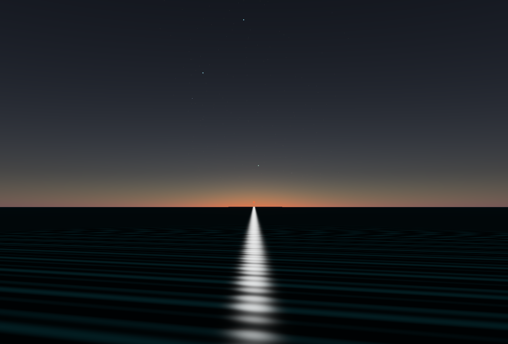 | 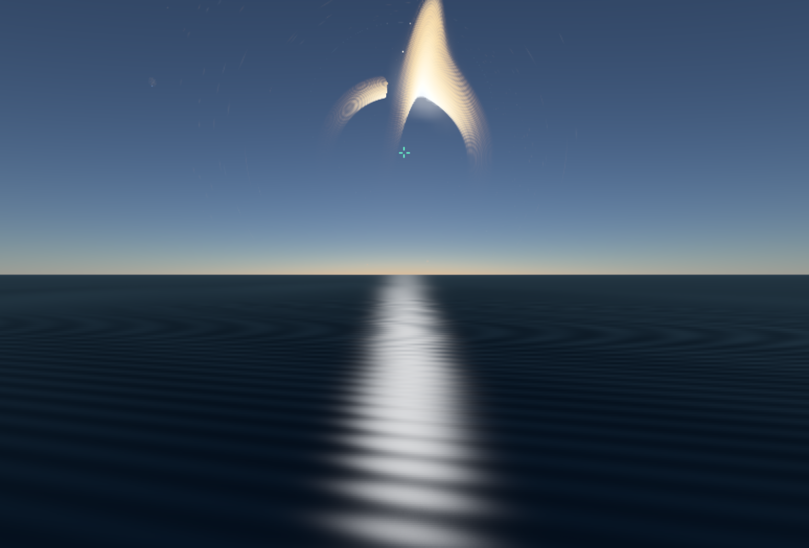 |

| Mann — frozen surface | Edmunds — rocky desert surface |
| --- | --- |
| 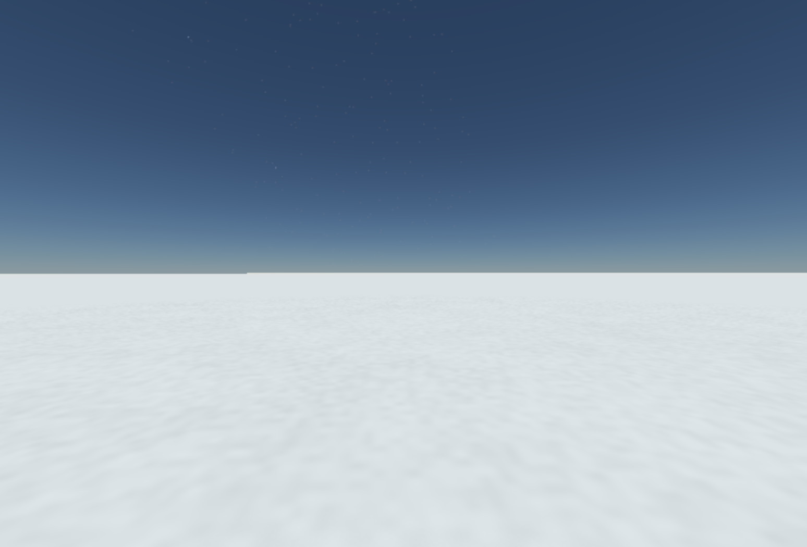 | 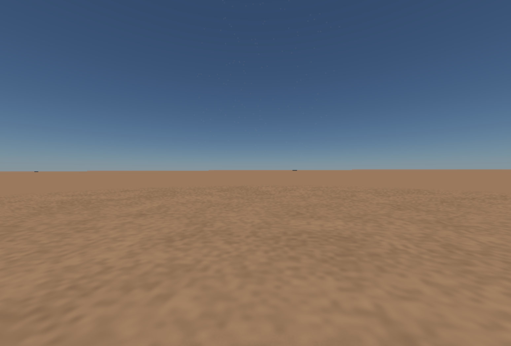 |

Saturn's ring system in the physical Solar preset:

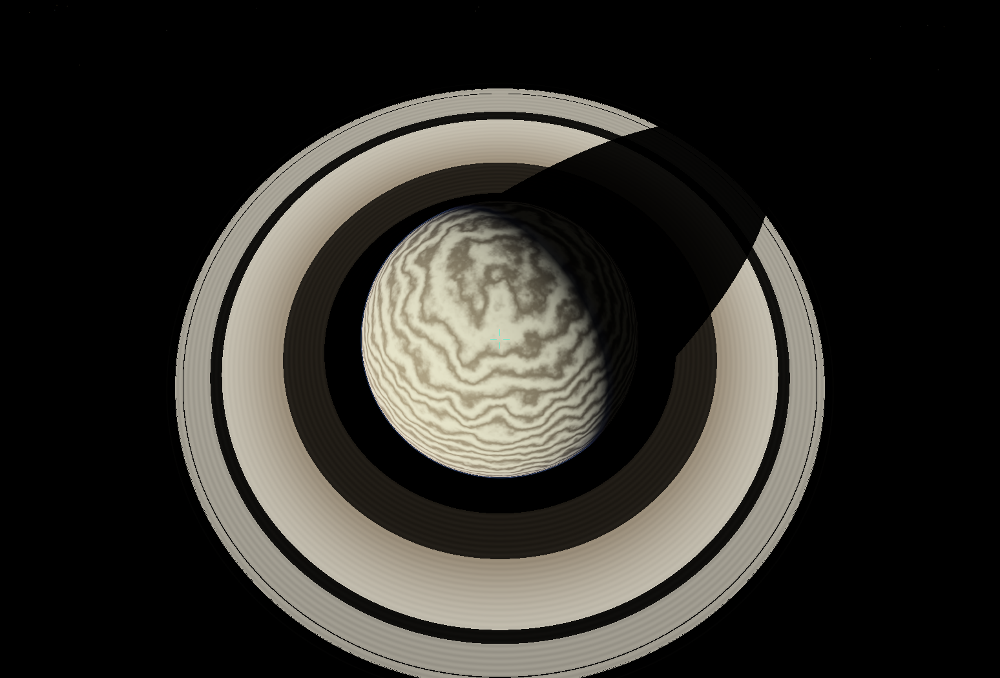

Endurance and Ranger interiors:

| Endurance | Ranger |
| --- | --- |
| 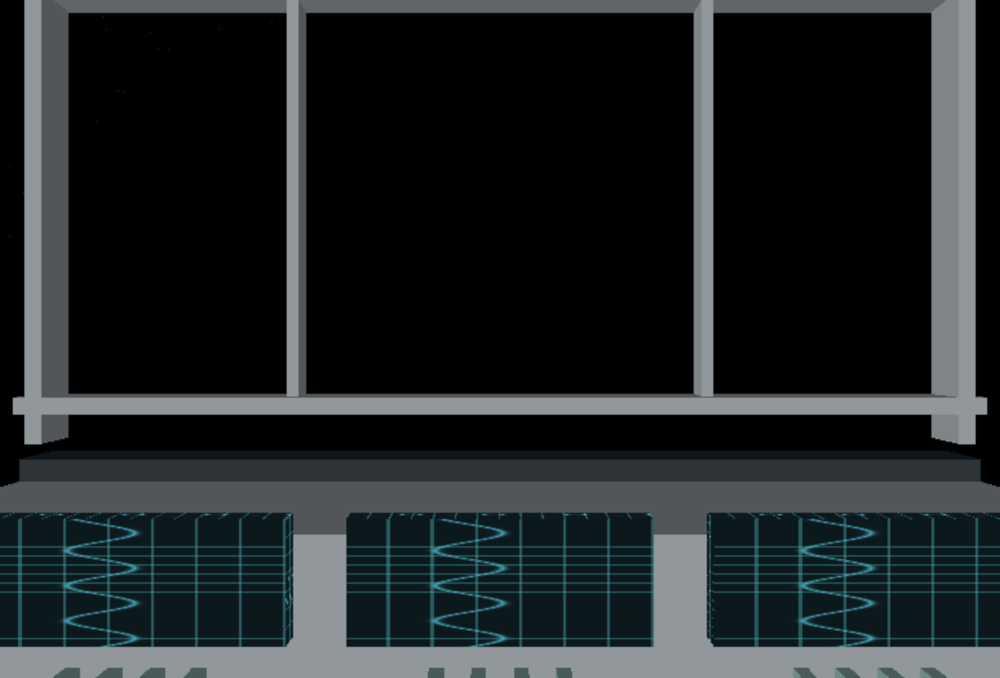 | 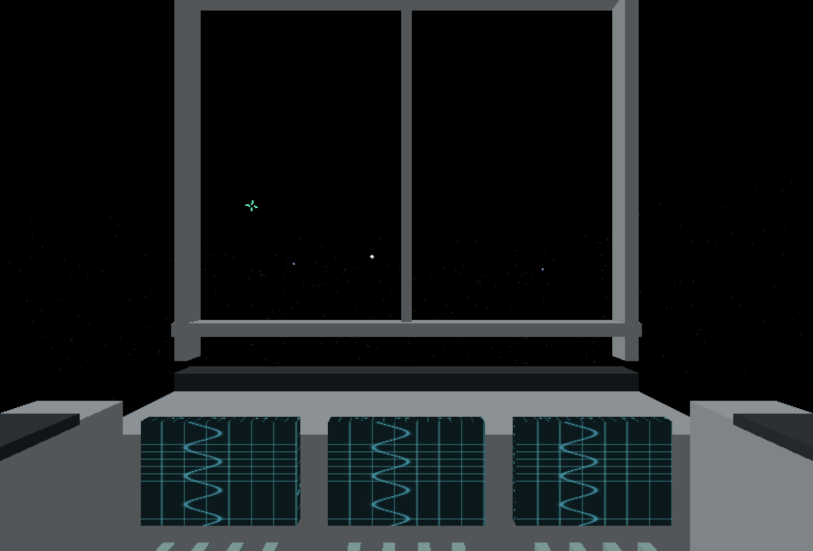 |

See [all refinement changes and reasons](docs/REFINEMENT_2026-11-11.md), [the earlier change log](docs/SIMULATION_CHANGES.md) and [DX12 migration status](docs/DX12_MIGRATION.md).

The [November 12 atmosphere and Moon fixes](docs/ATMOSPHERE_AND_MOON_2026-11-12.md) protect Miller's atmospheric rim from foreground lens distortion in orbital views and give the Moon neutral regolith colours while retaining its terrain relief.

## Change log and reasons

The entries below record earlier implementation stages. Current behavior is described above; later replacements and their reasons are recorded in [the current detailed log](docs/SIMULATION_CHANGES.md).

- **src/BlackHole.cpp** owns scene shaders, geometry, bodies, GPU light tracing, and rendering so simulation-specific graphics stay together. It generates shared sphere geometry, spacecraft ring geometry, and a deterministic background star field to avoid external asset dependencies. A full-screen shader traces light into the disk and horizon so the disk produces bent images. The ocean shader adds rotating swells, foam, and highlights so the planet can be inspected up close. The spacecraft controller, finite fuel, adaptive stepping, bounded trajectory buffer, and engine exhaust expose the result of force integration. Reset and manual boost allow the initial experiment to be repeated or altered. Metallic shading, spokes, and modules make the ring craft recognizable at close range.
- **src/BlackHole.h** declares scene initialization, updates, rendering, cleanup, and position queries. The camera uses the queries to follow the planet or spacecraft. It stores spacecraft state, fuel, and trajectory samples between frames.
- **src/OrbitalMechanics.cpp** contains the shared equations for mean motion, Kepler's equation, orbit orientation, analytic position and velocity, particle gravity and thrust integration, gravitational frequency ratios, and the GLSL relativity functions. Keeping these equations together lets the scene call them without embedding the physics throughout its rendering code. Analytic stellar orbits avoid accumulated integration drift during accelerated playback. The spacecraft integrates forces so booster commands change its subsequent trajectory. Input checks reject invalid ellipses, observer positions, and particle inputs.
- **src/OrbitalMechanics.h** declares the orbital parameters and equation interfaces. Scene distances use scaled units and orbital angles use radians.
- **src/WindowManager.h** adds scene ownership, scene selection, planet and spacecraft following, mouse capture, flight speed, time-rate selection, title refresh timing, and graphics cleanup declarations. These values persist between GLFW callbacks and frames.
- **src/WindowManager.cpp** initializes and renders the black-hole scene, adds native clickable Windows controls and keyboard equivalents, and routes successful model drops back to the model viewer. Mouse capture becomes explicit so the controls can be clicked. Vertical movement and adjustable speed support close inspection and travel. Camera motion remains usable while paused. Home and scene switching reset the view, and the flyby follows orbital translation. The title displays the local clock, playback multiplier, and flight speed. Playback starts paused so Space visibly starts animation. Observer movement stays outside the horizon for the static-observer redshift equations. Graphics cleanup releases scene buffers and shaders while the OpenGL context is available. Windows headers load before engine headers to avoid SDK symbol conflicts. V-sync reduces redundant GPU frames.
- **src/main.cpp** calls graphics cleanup before GLFW termination so GPU resources are released with a live context.
- **Render-Engine.vcxproj** includes the new source and header files so Visual Studio builds the scene and equations.
- **README.md** documents the controls, physics assumptions, CPU/GPU responsibilities, and reasons for the changes.

The spacecraft controls in **src/WindowManager.cpp** add close following, manual boost, reset, and a live flight-status title so the physical flyby can be inspected and repeated. The spacecraft view initially places the black hole behind the craft, matching the reference's viewing arrangement.

The shared sphere mesh in **src/BlackHole.cpp** uses higher tessellation to resolve the ocean displacement during close inspection. Its spacecraft attitude basis keeps the ring visible during the close flyby, and translucent blue-white exhaust makes the engine state visible.

- **src/PlanetTerrain.cpp and src/PlanetTerrain.h** add seeded 3D value noise, five-octave fBm, and a ridge contribution for Musgrave-style terrain. Shared vertex and fragment functions keep the displaced surface and its shading consistent. Elevation controls beaches, vegetation, rock, snow, and ocean-depth colors. CPU counterparts evaluate the same surface for camera collision. Sampling normalized 3D coordinates avoids a texture seam at longitude wrapping. These are procedural terrain approximations, with finite mesh resolution and a small camera clearance above the surface. [Musgrave fractal noise](https://docs.blender.org/manual/en/3.0/render/shader_nodes/textures/musgrave.html)
- **src/Atmosphere.cpp and src/Atmosphere.h** add GPU integration through an exponential atmosphere. Wavelength-dependent extinction and a Rayleigh-like phase function produce a blue limb, atmospheric haze, and attenuation of stars from the surface. Planet shadowing changes illumination between day and night. A copied scene texture allows atmospheric transmittance to affect the rendered space background. This uses a single-scattering approximation, illustrative density, a point light at the disk center, and spherical ground clipping. Clouds, weather, multiple scattering, and precise foreground-depth compositing remain future work. [Atmospheric scattering geometry](https://developer.nvidia.com/gpugems/gpugems2/part-ii-shading-lighting-and-shadows/chapter-16-accurate-atmospheric-scattering)
- **src/BlackHole.cpp and src/BlackHole.h** add two planets, per-planet terrain seeds, and an atmosphere on all three planets. A deterministic catalogue contains 1,024 nearby survey representatives, 576 wider Milky Way representatives and 5,400 stars across three additional galaxy groups. These finite, scaled star distributions have selectable positions and render as spheres nearby. Their galactic motion and mutual gravity remain unmodeled. Target queries supply current positions and names for selection and travel. Landing queries identify the nearest planet and its rotating surface.
- **src/BlackHole.cpp and src/BlackHole.h** also retain spacecraft position, velocity, and booster history. The displayed craft is sampled at an emission time whose estimated arrival matches the observation time. Historical engine state drives the visible exhaust. Navigation targets its current state. The trajectory line is a simulation guide showing its physical path. History samples become farther apart as the mission ages to limit storage growth.
- **src/OrbitalMechanics.cpp and src/OrbitalMechanics.h** add observer clock-rate estimates and direct-path light-travel delay with a first-order Shapiro term. The camera's velocity adds Doppler shifts and aberration to disk rays. Spacecraft light delay uses recorded Newtonian motion and a direct-path approximation. Strong-field multiple-image arrival times, complete relativistic body dynamics, and Kerr spin remain unimplemented. The model produces modest clock differences at these orbital radii. The film's years-to-hours ratio requires additional relativistic modeling. [Black-hole clock rates](https://www.nasa.gov/sites/default/files/atoms/files/black_hole_math.pdf)
- **src/WindowManager.cpp and src/WindowManager.h** add terrain regeneration, landing constraints, free-cam gravity, mouse picking, G travel, separate local/world clocks, and a light-age readout. Surface mouse-look uses the local up direction. Near clipping changes during landing to show nearby ground. Far clipping expands during space flight to include the generated star groups. Reset and flyby controls clear gravity and landing constraints. Pointing at a destination changes selection while the simulation continues.
- **src/BlackHole.cpp and src/BlackHole.h** add a bounded GPU point buffer for 128 photon markers and a detector marker. Packets use straight illustrative paths and playback time scaled by estimated travel duration. This debug view samples the disk and craft. The disk image itself continues to use the separate Schwarzschild ray integrator.
- **Render-Engine.vcxproj** registers the terrain and atmosphere source/header files so the normal Visual Studio build includes both features.

## Milky Way appearance

The Milky Way now uses NASA/JPL's detailed PIA10748 artist concept within its exterior LOD and illustrative 3D stellar/dust field. The face-on view shows blue-white arms, a warm central bar and pink star-forming regions; inside the disk, local stellar emissivity and dust extinction preserve the Galactic band. Catalogue stars remain separate selectable objects.

Actual engine captures (HDR):

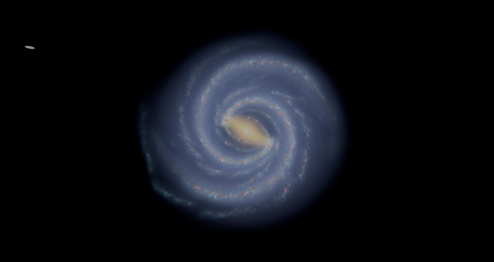

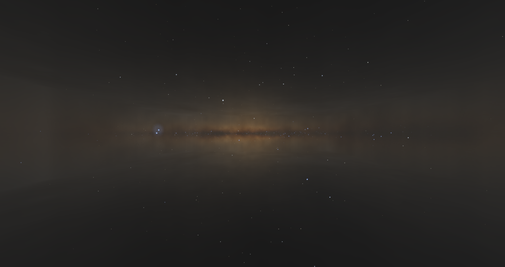

Appearance artwork: **Courtesy NASA/JPL-Caltech**, [PIA10748](https://www.jpl.nasa.gov/images/pia10748-our-milky-way-gets-a-makeover-artist-concept/). This is an artist's reconstruction. [Every change, reason, memory tradeoff and validation result](docs/MILKY_WAY_QUALITY_2026-11-12.md).
