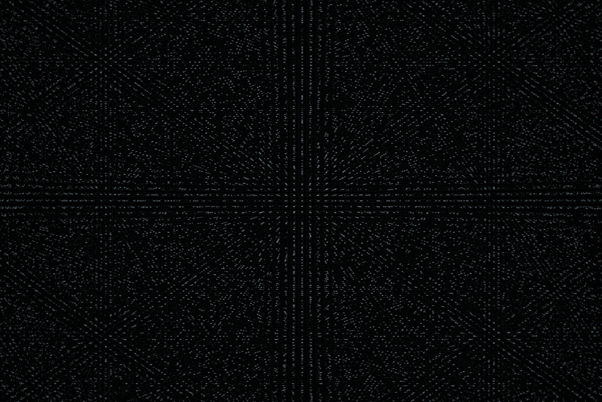
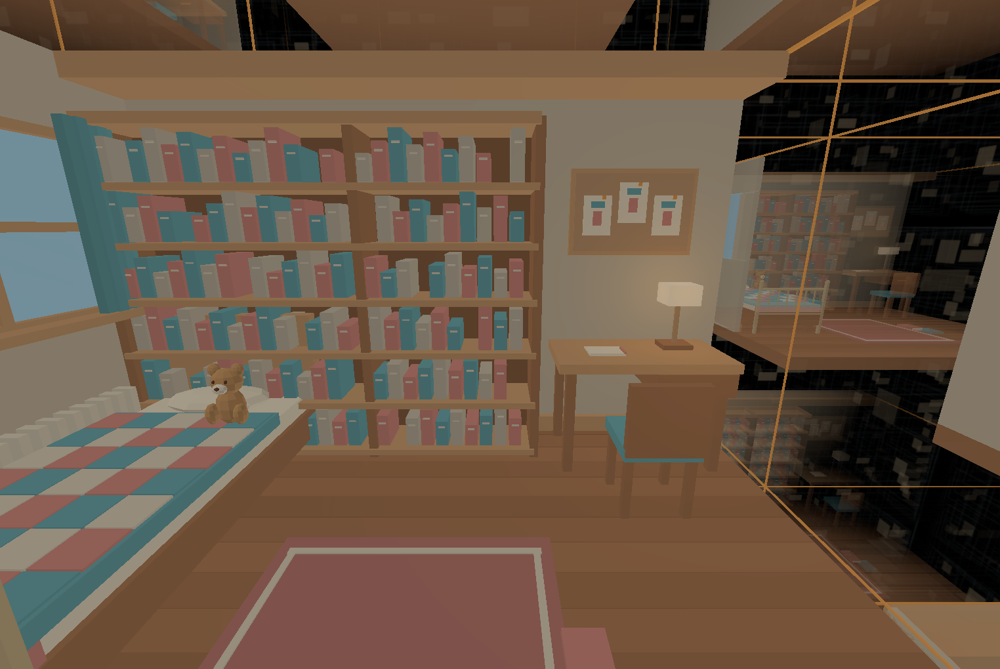

# Black-hole interiors and living terrain

All black-hole scenes allow horizon entry. Fly across a horizon or press **H** for physical free fall. Gargantua retains free-camera control across its horizon. Each galactic core uses its own radius, spin and local frame, including the physical observer used by the lens renderer. **Home** returns to an exterior view.

Ordinary black holes end in a dark interior at the Kerr integrator's numerical limit. Gargantua begins revealing the tesseract after the camera moves 1,000 km inward from its Kerr event-horizon radius. The distant view projects a procedural 192 × 192 × 192 lattice as dim windows. As the camera travels deeper, the nearest visible grid layers approach and give way to furnished rooms. Room geometry fades in between 71% and 55% of the horizon radius. Each room measures 4.4 by 3.6 metres with a 2.65-metre ceiling. It contains a child’s bed, quilt, stuffed bear, desk, chair and bookcase. Cutaway walls and ceilings let you see neighboring copies. The same world camera, orientation, field of view, speed and playback state continue throughout. Geometry uses a fixed chart at Gargantua's origin, with periodic rendering to repeat the rooms.

WASD and the ordinary look controls work throughout. R/F provides vertical free flight, and the wheel adjusts flight speed. **L** arms interior landing. Once the interior is fully revealed, gravity lowers the observer onto a room floor. Walking speed is capped for navigating the smaller rooms, and **L** releases landing in place. The gaps between rooms remain passable. **H** free fall continues from the incoming world velocity into the fictional interior.

The bedroom uses original geometry and takes its taller bookcases, metal bed frame and side window with radiator from Sohaib Ahmad’s visual reference. [Sketchfab bedroom](https://sketchfab.com/3d-models/murphs-bedroom-interstellar-bedroom-c417fa89eefa4e1a847912d3ef89e421)

The fall previews and supplied stills guided the progression from sparse, cool points of light to warmer architectural detail. [Gargantua descent clip](https://www.youtube.com/watch?v=SYoR_aRRhAs)

Living terrain is described in [Planet vegetation](PLANET_VEGETATION.md). Nearby land receives deterministic broadleaf, conifer or palm models, with distant silhouette cards and bounded instanced grass sprites. Lifeless worlds remain bare. The DX12 bridge supports the same instance step rates and depth comparison state as OpenGL.

Ocean waves use seeded three-dimensional wave vectors, wind-dependent amplitudes with steepness limits, deep-water dispersion and a second harmonic that sharpens crests. Fine wind ripples affect surface normals without adding geometry. Screen derivatives filter unresolved ripples. Windy crests receive broken whitecaps, reducing mirror reflection where foam scatters light. Displacement, normals and reflected weather share the same wave phases.

The tesseract approach Release checks passed 352 OpenGL scene captures and 361 DX12 scene captures, plus 14 interface captures each. Both reported zero assertion failures, and DX12 reported zero scene validation errors. The descent checks sampled 999 km and 1,001 km below the horizon to verify the cutoff. They also checked camera pose and playback continuity at four depths, plus room-floor landing, walking and release into free flight. Capture PNGs were checked against their raw RGB pixels.

The standalone simulation utility could not launch during the preceding continuous-descent validation. Windows returned “Access is denied,” and the launch logs are in the build history. The descent and landing checks ran inside both application render suites.

