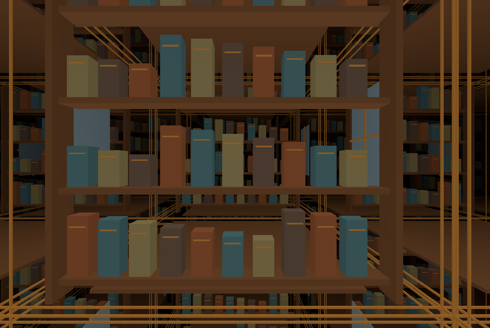
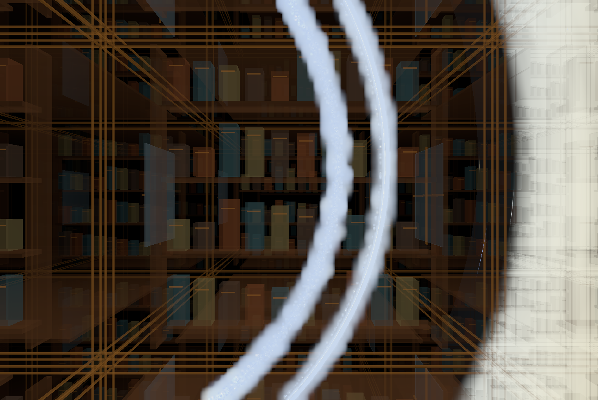
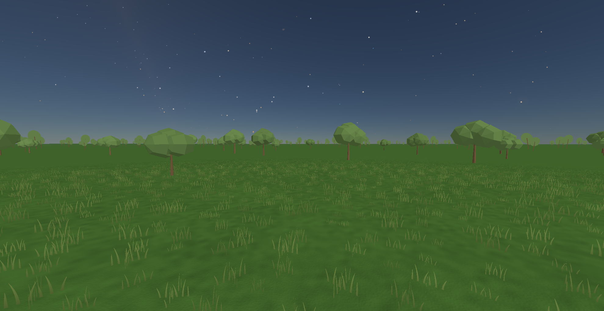

# Black-hole interiors and living terrain

All black-hole scenes allow horizon entry. The camera can fly across a horizon, or begin physical free fall with **H**. Gargantua retains free-camera control across its horizon; H toggles falling. Each galactic core uses its own radius, spin and local frame, including the physical observer used by the lens renderer. **Home** returns to an exterior view.

The Kerr integrator retains its numerical inner limit for ordinary black holes, which end in a dark interior. Gargantua instead reveals an original bookshelf-and-light lattice continuously with descent, from 92% to 55% of its horizon radius. Remaining stationary does not activate it. The same world camera, orientation, field of view, speed and playback state continue throughout. Geometry uses a fixed chart at Gargantua's origin; periodic rendering repeats the lattice without rebasing or teleporting the observer. This is a fictional interior, separate from the physical solver.

The ordinary look controls and WASD work throughout; R/F provides vertical free flight and the wheel adjusts the existing flight speed. **L** arms interior landing without changing the camera pose. Once the interior is fully revealed, gravity lowers the observer onto a deck, with swept floor collision and walking across its surface. L again releases landing in place. Empty gaps remain passable. H free fall continues from the incoming world velocity into the fictional interior instead of stopping at a numerical boundary. No timer, scene-spawn pose or reference-video camera path is imposed.

The supplied video was used only for its visual direction: warm white inner emission, amber filaments and deep surrounding darkness. No movie frames or models were imported. Other black-hole presets retain their own emission colours.

Living terrain is described in [Planet vegetation](PLANET_VEGETATION.md). Nearby land receives deterministic broadleaf, conifer or palm models, with distant silhouette cards and bounded instanced grass sprites. Lifeless worlds remain bare. The DX12 bridge supports the same instance step rates and depth comparison state as OpenGL.

Ocean waves now use seeded three-dimensional wave vectors, wind-dependent amplitudes with steepness limits, deep-water dispersion and a second harmonic that sharpens crests. Fine wind ripples affect surface normals without adding geometry; screen derivatives filter unresolved ripples. Windy crests receive broken whitecaps, reducing mirror reflection where foam scatters light. Displacement, normals and reflected weather share the same wave phases. This is a bounded visual wave model rather than a fluid solver.

The continuous-descent Release checks passed 351 OpenGL scene captures and 360 DX12 scene captures, plus 14 interface captures each. Both reported zero assertion failures; DX12 also reported zero scene validation errors. Four descent depths verify unchanged position, view, FOV, speed, world time and playback state. Further checks cover a stationary observer, gradual deck landing, walking, release into free flight and uninterrupted falling. The wider suite covers the paired wormholes, other black-hole horizons, living terrain and wind-driven oceans. All 365 OpenGL and 374 DX12 PNGs were compared against every raw RGB pixel.

The standalone simulation utility compiled but could not launch in this session (Windows returned “Access is denied”). The new continuity and landing checks executed successfully inside both application render suites; standalone launch logs are retained with the build history.

Both current application launchers passed eleven further interface checks and pixel-validated captures after promotion. Superseded application builds and duplicate captures were removed, retaining both renderer variants, source/assets, current incremental caches and useful text logs.

