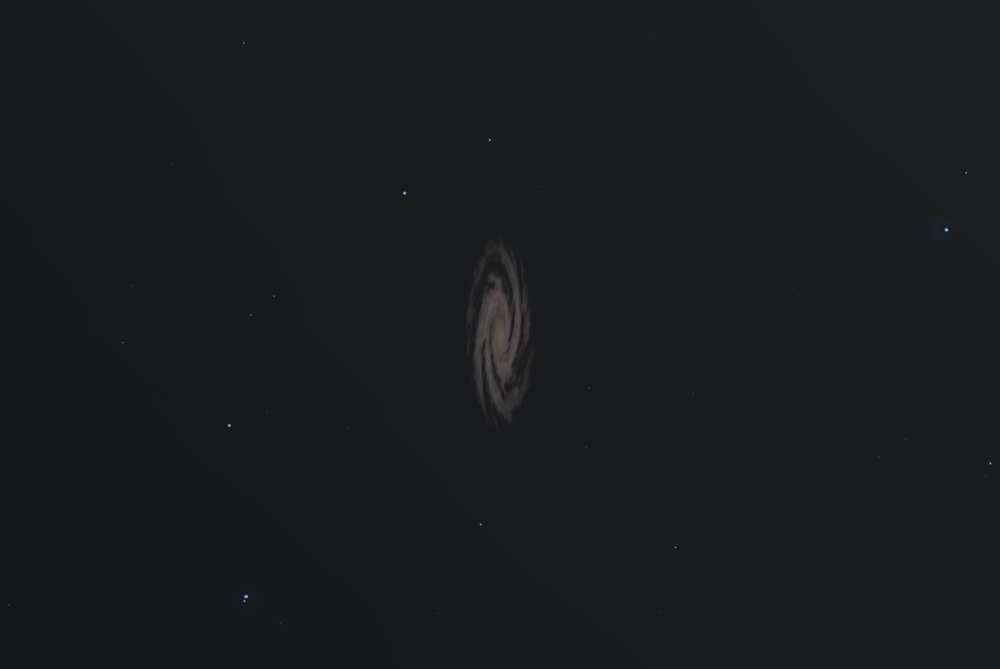
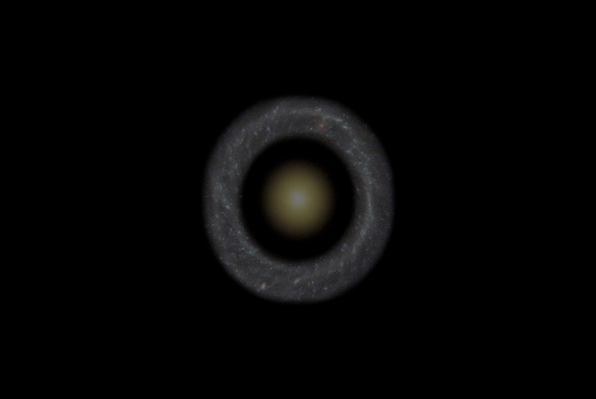

# Porous spiral arms and Hoag's Object

The galaxy texture was the main source of the remaining cutout appearance. In a sampled interior annulus (0.2–0.8 image radii), the original PNG averaged **0.988 alpha**, with every sample above 245/255. The edited asset averages **0.632 alpha** there: about **24%** of samples are below 64/255 and another **41%** are partially translucent. This changes the actual PNG's gaps between spiral arms, rather than just blurring its outline.

## Changes and reasons

| File | Change | Reason |
| --- | --- | --- |
| `assets/galaxy.png` | Replace the uniformly filled spiral with an edited RGBA version, preserving the nucleus, orientation, blue-white arms, dust lanes and pink knots. Add irregular low-alpha gaps and diffuse wisps. | Empty inter-arm space should show the sky instead of appearing as a grey solid disk. The texture is still an illustrative generated asset, not an observation of M31. |
| `src/GalaxyBackground.cpp` | Keep low-alpha wisps; feather the outer 65% of the projected radius gradually into the sky. Preserve additive light blending and the non-emitter mask. | A narrow square-border fade cannot hide a circular rim baked into the artwork. Background light and stars must remain visible through the outskirts. |
| Same renderer / header | Add a separate sRGB Hubble image sampler for Hoag's Object. Centre it on the observed nucleus and mask photographic sky plus the empty space between nucleus and ring. | Hoag needs a detached blue ring and yellow core, rather than the spiral morphology. The downloaded JPEG is preserved unchanged; its sky removal occurs in the rendering shader. |
| `src/NearbyGalaxies.h` | Add Hoag's name, aliases, catalogue centre, V magnitude and an approximate full outer-ring extent/distance. | It is a named, correctly placed catalogue object, distinct from the procedural distant field. |
| Same galaxy renderer | Replace the hardcoded count of four catalogue galaxies with the actual catalogue size. | The added fifth entry must not be culled as part of the fictional distant sprite field. |
| `src/NavigationCatalog.cpp`, `src/WindowManager.cpp` | Make Hoag searchable by its name, PGC 54559 and the user's spelling “Haog”; retain select-first navigation and explicit Go to. Show its ring classification, size and image credit. | The object must be discoverable and its observed image distinguishable from illustrative galaxy textures. |
| `src/AssetManager.cpp` | Decode image uploads to RGBA, preserving existing PNG alpha. | The Hubble JPEG is 1521 pixels wide: tightly packed RGB rows are not four-byte aligned. RGBA avoids skewed row uploads without leaking pixel-store state. |
| Both project files | Deploy the Hubble JPEG with each application. | Both normal launchers and staged validation builds must contain the actual asset. |
| `src/RenderChecks.cpp` | Check alpha gaps in the deployed PNG, measure fading core/middle/outskirts over a coloured background, verify light behind an edge is preserved, and check Hoag's yellow nucleus, blue ring and detached gap. Exercise named navigation, HDR and auto exposure. | Validate the actual assets and rendered result, including the failure mode shown in the supplied screenshot. |

The reference montage depicts a future galaxy encounter. It is used for the diffuse light/transparent-edge appearance only; existing present-day catalogue coordinates and sizes are retained.

## Hoag's Object data and image

- J2000 centre: **RA 229.31002860781°, Dec +21.58551562657°**; V magnitude **15.1**, from the [SIMBAD catalogue](https://simbad.cfa.harvard.edu/simbad/sim-tap), queried 2026-11-17.
- Adopted approximate distance: **600 million ly**. The full outer ring is **120,000 ly** across, with an inner edge around **75,000 ly**, using [NASA's Hubble release](https://science.nasa.gov/asset/hubble/ring-of-hot-blue-stars-pinwheels-around-yellow-nucleus-of-hoags-object-galaxy/). This gives a full outer angular extent near **0.688 arcmin**. SIMBAD's smaller **0.342357 × 0.31757 arcmin** optical extent is a different brightness-boundary convention; it is not used to truncate the faint outer ring.
- Asset: `assets/galaxy-hoag-hubble.jpg`, the unchanged **1521 × 1489** Hubble WFPC2 B/V/I composite. Credit: **NASA and The Hubble Heritage Team (STScI/AURA); acknowledgment: Ray A. Lucas (STScI/AURA)**. [Original download](https://assets.science.nasa.gov/content/dam/science/missions/hubble/releases/2002/09/STScI-01EVT98Q06DQ0D2A6EZFQMED83.tif/jcr:content/renditions/1521x1489.jpg).

Use **F3**, search **Hoag's Object** (or **Haog**, **PGC 54559**), select the entry and choose **Go to**. At the default stellar/galaxy magnitude limit, this faint object is naturally not visible from Earth. It becomes resolved when approached. This adds an observed appearance/navigation object, not a new population of individually simulated stars or a reconstruction of its unknown formation history.

## Spiral asset edit

The built-in image editing tool edited the existing project texture with genuine transparent output. The selected result was copied to **`assets/galaxy.png`**, replacing the user-requested asset while preserving its alpha channel. The original generated output remains in the normal generated-image library. Final prompt:

> Use case: precise-object-edit, scientific-educational. Edit target: the supplied face-on spiral galaxy texture for a realtime space simulation. Preserve its centered face-on orientation, full circular extent, compact warm cream nucleus, intricate blue-white spiral arms, dark dust lanes and subtle pink star-forming knots. Change its opacity structure: it currently looks like a solid opaque pancake, including the gaps between arms. Remove that uniform gray filled disk. Make broad irregular spaces BETWEEN spiral arms genuinely transparent or very low alpha, with scattered faint translucent wisps instead of an opaque base. Retain luminous textured arms, with varied partial alpha along wispy branches, small transparent openings and a smoothly feathered diffuse outer halo. Arms must dissolve gradually into transparency; no hard cutout rim, no solid circular edge. The core stays bright and mostly opaque. This is an isolated RGBA light-emission sprite: empty inter-arm space and all outside corners must have actual transparency, not black or a checkerboard painted into RGB. No sky, stars outside the galaxy, perspective, text, border, lens flare, or watermark. Keep the galaxy identity and scale; no extra objects. Aim for detailed astrophotography-like texture with porous, translucent arm structure and restrained color.

## Validation

The ordinary Release applications passed **263 DX12 scene captures + 14 UI captures**, and **254 OpenGL scene captures + 14 UI captures**, with **zero failed assertions** and **zero DX12 validation errors**. All **277 DX12** and **268 OpenGL** PNGs were verified against every raw framebuffer RGB pixel before removing raw captures. The CPU suite also passed all 38 quantum presets, solar-scale/hierarchy checks and deterministic generation of two million stars.

The deployed spiral texture contains 179,318 low-alpha inter-arm pixels and 292,001 partially translucent pixels in the checked annulus. In the coloured-sky render check, the outskirts emit about **3.1%** of the core signal, and a background marker remains visible. Hoag's yellow nucleus, bluer ring and dark detached gap pass separate rendered colour/contrast checks.

Both normal launchers passed another **11 UI captures each** after promotion; those PNGs were also verified against their raw pixels. Their executable hashes match the validated Release candidates. The superseded application outputs and old capture sets were removed; raw/duplicate capture cleanup alone recovered **2,815.5 MiB**, including 60 duplicate PNGs. Temporary import fixtures were removed separately. Both current renderer variants, their incremental caches, useful text logs and retention manifests remain under `build/`.

## Engine captures

