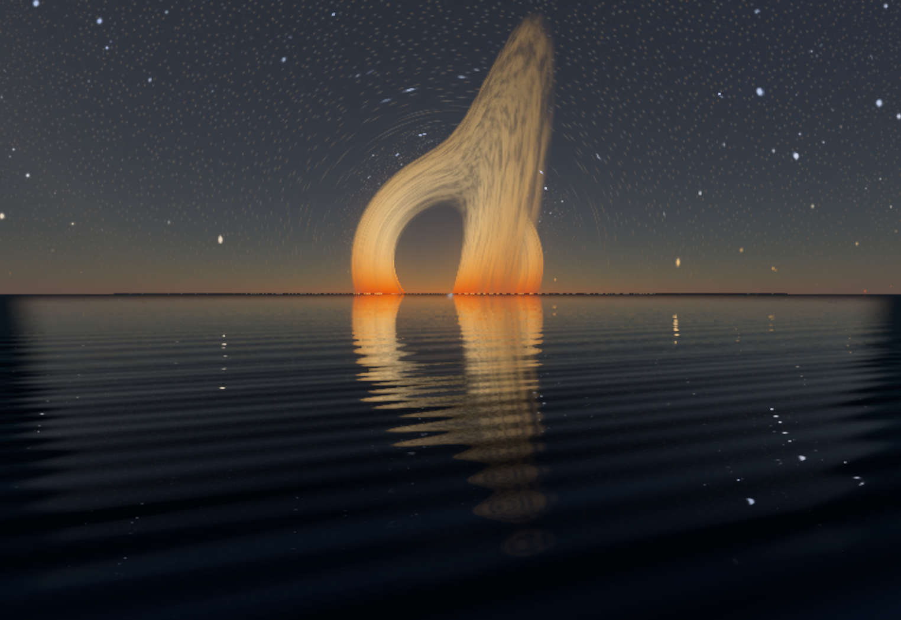
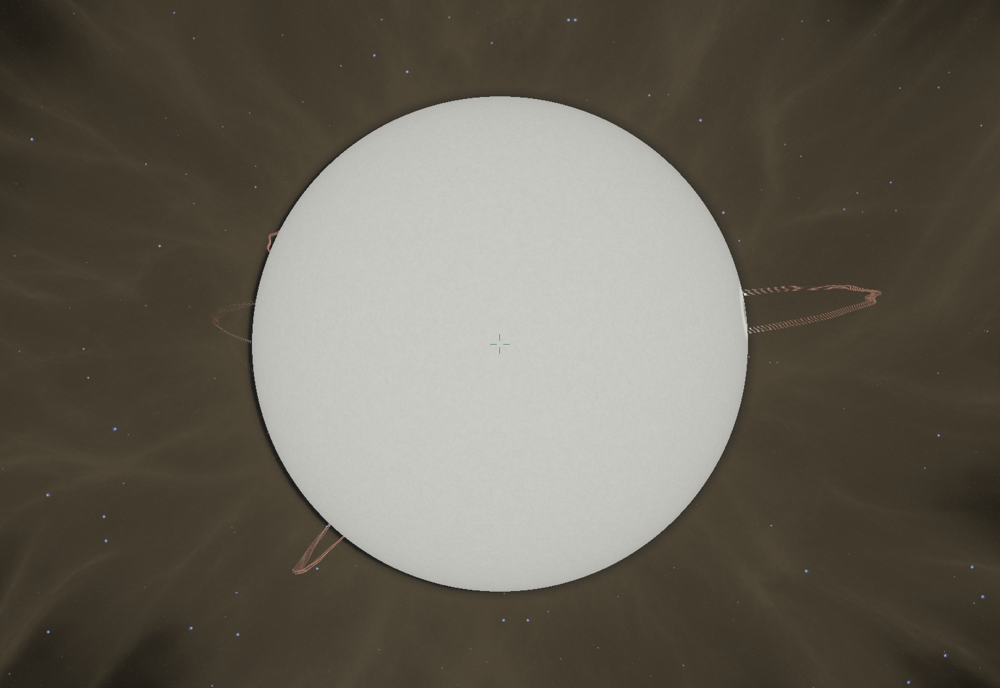

# Exposure, transparent emission, Miller water and TON 618

This change addresses the supplied exposure, galaxy transparency, disk-edge, Miller atmosphere/reflection and TON 618 references. It uses original shaders and existing project assets; no SpaceEngine screenshot or proprietary code is included.

## Changes and reasons

| Area / files | Change | Reason |
| --- | --- | --- |
| `StellarActivity.cpp` | Normalize resolved photospheres to a scene-linear emitter scale, with bounded temperature dependence; reduce the strong orange display tint. Replace thick tubular prominence wires with 6,144 GPU-advected, soft elongated particles along seeded magnetic arches. Use brighter warm-white footpoints and weaker red edges; retain surface activity and the existing corona PNG. | Resolved stars previously had radiance comparable to ordinary materials, while distant catalogue points could be much brighter. The particle filaments follow the supplied arch/footpoint reference without uniformly orange solid loops. A visible Sun dominates automatic exposure. The colour and radiance scales are illustrative, not measured spectral radiometry. |
| `ExposureMeter.cpp` | Meter the upper 90th percentile of a resolved accretion disk instead of the 75th; require an emitter mask for resolved photosphere samples; combine resolved-object and scene-average targets conservatively. | A small beamed core can still clip, but the disk lowers exposure enough to suppress faint background light. A planet crossing the host's screen location cannot masquerade as its emitting photosphere. Lens artifacts remain outside metering. |
| `CameraOptics.h/.cpp` | Copy local depth once per newly rendered scene. In auto exposure, give finite non-emissive ordinary materials a bounded readability grade, excluding high-radiance reflections/emission. Compress the resolved host before HDR bloom, including peripheral-eye samples; preserve uncovered sky at filtered limbs. Classify bright photosphere pixels independently of the optical-source mask cleared by prominences. | Auto exposure suppresses distant stars while keeping local planets readable, as requested. HDR preserves both the bright host and the faint sky without a dark annulus or ungraded white marks under prominences. The local-object grade is deliberately a multi-exposure presentation, not a single physical shutter exposure. Cached frames reuse the copied depth. |
| Same optics shader | Add thin horizontal and vertical thermal-coloured diffraction components, strongest in the telephoto profile, with finite-source suppression and existing primary-source priority. | Compact star points get a coloured cross without relocating the closest bright host's optical centre. Existing broader glare signatures are retained for later refinement. |
| `BlackHole.cpp` | Replace the thin disk's opaque ray termination with front-to-back emission and density-, radius- and incidence-dependent transmission. Feather the surrounding thin plasma radially, attenuate emission behind previous crossings, and retain true horizon capture. | The outer disk no longer acts as a hard black cutout. Dense inner gas can still be opaque. This is integrated along the existing curved light rays, rather than alpha-blending a flat overlay. |
| Same lens shader | Track the first emitting crossing separately from the final ray endpoint. Keep foreground geometry guards and avoid writing opaque depth for rays that continue through thin gas. Extend the transmission diagnostic to thin disks. | Foreground planets, spacecraft and their air must not be replaced or clipped by a transparent disk crossing. Independent Kerr capture diagnostics still distinguish gas-emitting rays from unobscured escape/capture rays. |
| `Atmosphere.h/.cpp` | Solve spherical intersections in planet-radius units using stable quadratic roots. Use quadratically spaced camera-path intervals, concentrating the existing 12 samples near the observer. | Near-surface metre-scale differences are poorly represented by subtracting nearly equal AU distances. Dense nearby air also needs more of the existing sampling budget than the thin upper shell. |
| Same atmosphere pass; `BlackHole.h/.cpp`, `StarSystem.h/.cpp` | Add screen-space reflections to Miller and atmospheric ocean worlds. Run the reflection resolve after the atmosphere and cloud volume have been composited. Use bounded depth marching for finite receivers and a direction lookup for the distant sky/accretion emission. Derive macro-wave normals from actual water depth and add the material's two travelling metre-scale wave terms, Fresnel response and screen-edge fading. | The water reflects the actual visible stars, lensed Gargantua and volumetric weather. A separate resolve sees completed clouds rather than the earlier clear sky. Opaque dry objects and sky pixels cannot become water receivers. |
| Same material/atmosphere shaders | Carry a bounded water/specular marker below the flare-emitter threshold, preserve it through clouds and update the analytic contribution for air extinction. Subtract the analytic white specular stripe according to valid SSR confidence before adding reflected light. Reject same-water reflection hits, damp quantized depth slopes, and fade reflection confidence at the local horizon. | The generic white streak must not sit on top of the wave-distorted reflection or reappear by reflecting itself. Its fallback remains available when the reflected source is outside the frame. Logarithmic depth quantization must not turn grazing reflections into large square glints. Water never becomes a stellar lens-flare source. |
| `GalaxyBackground.h/.cpp` | Decode display artwork as sRGB, scale its emitted light with apparent surface brightness, soften low-density edges and add light without covering the sky. Keep galaxy pixels in a non-emitter optical class and draw catalogue stars afterward. | The previous treatment of display RGB as linear light made galaxies look like pasted bright cutouts. Galaxies must not trigger stellar lens flares, and overlapping sprites must not erase stellar emitter masks. |
| Same galaxy renderer | Fade the fictional distant sprite field out inside 40 kpc of the Galactic centre and back in by 100 kpc. Add four catalogued nearby galaxies independently. In auto exposure, a large bright catalogued galaxy lowers only the galaxy visibility limit; refresh the lensed sky when this mode changes. | Near Earth, giant randomly placed galaxy sprites should not replace the actual neighbouring galaxies. At large distances the existing illustrative universe remains populated. Galaxy-specific visibility does not change star identities, star batches or the user's stellar magnitude limit. Direct and lensed galaxy views must share the same mode. |
| `NearbyGalaxies.h` | Store four J2000 centres, optical angular axes/position angles, V magnitudes and rounded distance estimates. Build world positions and projected orientations from them. | Andromeda, Triangulum, LMC and SMC appear in the correct directions and at catalogue angular scales from the Sun. Their detailed internal artwork remains illustrative. |
| `NavigationCatalog.cpp`, `WindowManager.cpp` | Add named galaxy/alias lookup, Universe hierarchy entries, explicit Go to handling and concise catalogue information. | These galaxies can be found by M31/NGC224, M33/NGC598, LMC and SMC; selecting still does not teleport. Their navigation IDs cannot accidentally be interpreted as procedural-core IDs. |
| `BlackHole.cpp` | Give TON 618 its own thick, transmitting volume with sheared turbulent knots, a rounded torus profile and narrow polar outflows. Apply gravitational/orbital frequency shifts to disk emission and directional Doppler shifts to the outflow. | The former thin sheet plus broad glowing cones did not resemble the supplied thick-disk references. TON 618 now uses a different gas model from Gargantua and Sagittarius A*. |
| `StarSystem.cpp` | Frame TON 618 from an oblique angle in its disk frame. | Its original near-edge-on view hid the disk cavity and made the volume look like a flat wall. |
| `BlackHole.h`, `ObjectEditor.h/.cpp`, `WindowManager.cpp` | Add selection-bound disk thickness and temperature controls to F5, with finite-number/range validation and immediate redraw. Keep Gargantua spin controls unchanged. | The fluffy visual style can be tuned independently of Kerr geometry. Changes remain attached to their selected black hole. Information panels stay free of added shortcut instructions. |
| `GalacticCore.cpp` | Describe the TON model and its observational limits accurately. | The local gas/jet appearance is not a resolved observation of TON 618. |
| `RenderChecks.cpp` | Add reflection on/off, landed-air, partial-disk-transmission, synthetic bright-emitter/local-planet exposure, nearby-galaxy navigation/visibility and TON volume/editor checks. Retain existing Kerr, foreground-craft, atmosphere-shell, flare-independence and DLSS-mask regressions. | Check the rendered behavior and interactions, including input rejection and unchanged stellar submission under galaxy-only visibility changes. |
| README and this report | Add real engine captures, controls, sources and practical limitations. | Keep the change reviewable without implying that illustrative rendering is a measured simulation. |

## Nearby galaxy data

Centres, optical angular axes, position angles and V magnitudes were retrieved from the [SIMBAD TAP service](https://simbad.cfa.harvard.edu/simbad/sim-tap) on 2026-11-17. The query joined `basic`, `ident` and `allfluxes` for M31, M33, LMC and SMC. Optical extents are catalogue conventions, not sharp physical boundaries; different surveys/bands yield different values.

| Name | RA (deg, J2000) | Dec (deg, J2000) | Major × minor (arcmin) | PA (deg) | V magnitude | Adopted distance (ly) |
| --- | ---: | ---: | ---: | ---: | ---: | ---: |
| M31 | 10.6847083333 | 41.2687500000 | 199.53 × 70.79 | 35 | 3.44 | 2,540,000 |
| M33 | 23.4620690622 | 30.6601751120 | 60.26 × 35.48 | 22 | 5.72 | 2,730,000 |
| LMC | 80.8941666667 | -69.7561111111 | 322.82666 × 274.77 | 170 | 0.4 | 163,000 |
| SMC | 13.1583333333 | -72.8002777778 | 158.11333 × 93.105 | 45 | 2.2 | 200,000 |

Distance context: [NASA's Andromeda overview](https://www.nasa.gov/universe/galaxies/andromeda-galaxy/) gives approximately 2.5 million ly; the adopted 2.54 million is a rounded catalogue-scale estimate. [NASA's Triangulum mosaic](https://science.nasa.gov/asset/hubble/triangulum-galaxy-m33-crop/) lists 2.73 million ly. [NASA's Swift Magellanic Cloud survey](https://www.nasa.gov/universe/nasas-swift-produces-best-ultraviolet-maps-of-the-nearest-galaxies/) gives 163,000 and 200,000 ly. These are static local positions without proper-motion integration or cosmological evolution.

## Controls and limits

Select a black hole, open **F5**, and use **Apply disk** after changing thickness or temperature. Thickness ranges from **0.25 to 3×** the preset. Temperatures range from **1,000 to 40,000 K**, except the hot Sagittarius A* flow, which accepts up to **10⁹ K**. This does not make its optical spectrum a literal billion-K blackbody. Values are session settings, not saved object edits. The existing editor only exposes spin editing for Gargantua.

Water reflections are bounded to **24 finite-depth steps** and a distant-direction lookup. A second colour snapshot/resolve runs only within **1.04 planetary radii** of an eligible ocean world, after atmosphere and weather. Volumetric clouds are reflected as they appear in the rendered frame; this does not separately march a cloud volume for every reflected ray. Offscreen sources and geometry hidden from the main scene cannot be reconstructed. Reflection confidence fades at the frame edge, and the analytic water specular is retained in inverse proportion to that confidence. This is not ray-traced global reflection. It reuses the current colour/depth textures; no per-frame CPU image readback or water-particle simulation is introduced.

Prominence particles follow analytic magnetic arches, advected by simulation time; pause freezes them. Their six-vertex quads submit **36,864 vertices**, versus **221,184** for the prior 72 tube instances. Soft overlapping trails, per-filament offsets and brighter footpoints give a fine flowing structure. These are GPU particle trajectories with an illustrative multi-temperature palette, not a magnetohydrodynamic plasma simulation or literal visible-light observation. The existing transparent corona PNG is retained.

TON's volume uses **four gas samples per existing geodesic segment** and at least a 256-step ray budget. Gas turbulence is analytic and simulation-time driven. It is not GRMHD, a fluid solver, an observed jet reconstruction, or an exact reproduction of a proprietary renderer. Existing DLSS Super Resolution support is retained; Ray Reconstruction and Frame Generation are not added by this change.

The four nearby galaxies are appearance/navigation entries, not newly populated physical galaxy simulations. Existing deterministic star generation and magnitude/frustum batch culling remain in place. Galaxy-only visibility evaluates four distances on the CPU; it does not scan millions of star positions. The sRGB correction and transparent edge treatment apply to the existing three illustrative morphology assets as well.

## Validation and build retention

Both ordinary Release candidates passed the complete GPU suite: **DX12 257 scene + 14 UI captures**, **OpenGL 248 scene + 14 UI captures**, **zero failed assertion locations**, and **zero DX12 validation errors**. The simulation/navigation suite passed all 38 quantum presets, deterministic two-million-star generation, hierarchy/precision, time dilation and the Mann flyby checks.

The isolated exposure probe increased emitter radiance fourfold: background **0**, local planet **101**, emitter **208** (red display-channel values) in both cases. HDR photosphere values remained **235 versus 237** across a deliberately cleared optical mask. Flare strength/lens changes left exposure unchanged. Miller's atmosphere produced **zero nonfinite values and zero changes outside its allowed shell** at orbit, atmospheric entry and the near-ground pose. The GPU transmission diagnostic found **31,529 DX12 / 31,553 OpenGL** partially transmitting thin-disk pixels. Independent Kerr/Carter capture references passed. DX12 exercised **40 actual DLSS evaluations and 9 history resets**, retaining the optical masks.

An ocean-only difference-of-differences check confirms that volumetric weather changes the **reflection contribution**, not just the direct sky. Another check confirms that SSR removes the old analytic specular contribution on Miller instead of simply adding more light. Every replacement PNG is decoded and compared against **every RGB pixel** of its raw capture before raw files are removed.

Release candidates are built separately from both stable application launchers and inspected before promotion. Replaced outputs remain available until the normal launch paths pass their UI smoke checks. Source, assets, current incremental caches and useful text logs are retained; superseded applications and duplicate/obsolete captures are removed with absolute-path and reparse-point checks under `build/`.

Both promoted launchers subsequently passed **11 native UI smoke captures** each. Only the current OpenGL and DX12 application executables remain under `build/`. Superseded application folders and old capture sets were removed; validated raw captures and 60 duplicate PNGs accounted for **2,759.5 MiB** additionally reclaimed. The build promotion hashes, capture deduplication map and cleanup summary are retained in `build/optics-build-promotion.json`, `build/optics-capture-deduplication.json` and `build/optics-retention.json`.

