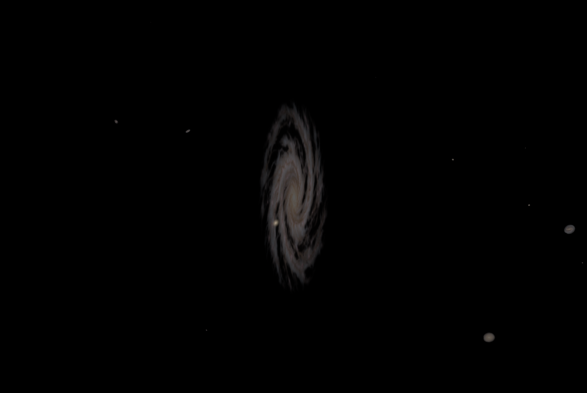
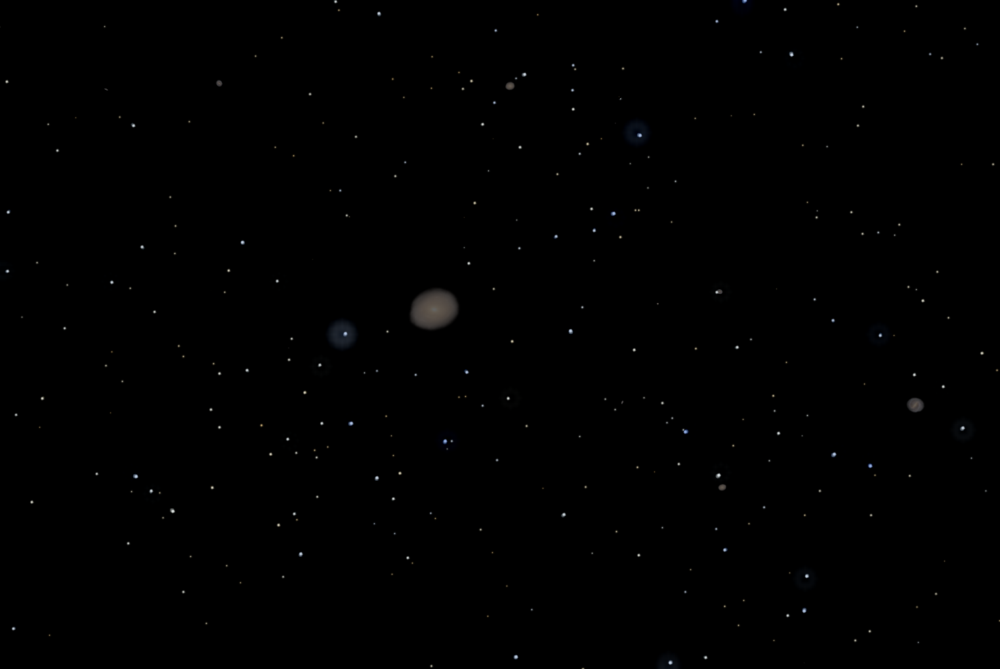

# Seeded star cells, galaxy density and M32

The bright sphere in the supplied screenshot came from a dedicated population of **262,144 procedural stars inside a fixed 2,500 ly Solar-neighbourhood sphere**. Those entries now follow the galaxy-wide density distribution. The old minimum point brightness has also been removed: a remote star fades with its apparent flux instead of remaining artificially visible.

## Generation and camera rendering

The renderer keeps the existing two-million-entry far-star catalogue and its spatial batch culling. A second, lazy population supplies local detail wherever the camera travels. Its identity encodes the galaxy, spatial cell and candidate slot; the world seed fixes its position, properties and planetary system. Leaving and revisiting a cell reproduces its contents exactly. Camera movement never changes a star's world position.

Cells follow each galaxy's centre and orientation. In the Milky Way, candidate acceptance follows the existing continuous disk, spiral-arm, bar/bulge and halo model, including vertical thinning and warp. Other galaxies use their matching spiral, elliptical or ring density model. Stars become less numerous in low-density outskirts; empty intergalactic space does not acquire a camera-centred star cloud.

All **266 existing galaxy domains** share the system: the Milky Way, three original procedural galaxies, six named catalogue galaxies including M32, and the 256 distant procedural galaxies. Distant sprites now read the same galaxy generator as their local stellar cells, avoiding separate locations for the picture and its stars. The distant galaxies are searchable as **Field galaxy 1–256**.

The virtual namespace has **1,879,048,192 candidate addresses**. These are potential sample locations, not that many allocated stars or a claim of a measured stellar census. Density rejects empty candidates; only cells near the current camera are materialized. The main domains use 64³ cells with 512 candidates each; the distant field uses 32³ cells with 64 candidates each. Cell contents are retained while resident and evicted after travel. A stationary camera does not regenerate or re-upload them.

Magnitude determines which apparent stellar brightnesses are eligible and expands the local streaming range. It also raises the point-display sensitivity above magnitude 7, so newly detectable faint stars actually become visible on the screen, while preserving their relative flux and catalogue properties. A bounded range protects memory and upload cost; point luminosity fades smoothly through the outer 35% of that range, before cells can unload. The independent far-star layer remains visible where its apparent magnitude permits. This is a hybrid spatial-cell/detail system, not a reproduction of SpaceEngine's proprietary renderer or a complete astrometric catalogue.

Remote wormhole environment captures use the far layer without replacing the active camera's local cells. This preserves selection, nearest-object queries and local residency when the remote sky is refreshed.

## Controls and navigation

- The information panel now has separate **Stars** and **Galaxies** magnitude controls. Defaults are 7 and 14 respectively, each with minus/reset/plus buttons. Zoom increases both effective limits relative to their own base setting.
- A higher magnitude limit reveals fainter objects. It is a brightness threshold, not a fixed distance clip. This distinction follows [SpaceEngine's magnitude documentation](https://spaceengine.ucoz.ru/index/magnitude/0-42), which also documents separate star and galaxy settings.
- Streamed objects are named **Seed star &lt;identity&gt;**. Click to select; use **G** or **Go to** to approach. Their full names remain searchable with **F3** after their cells have unloaded. Their generated planets, parent galaxy and nearby resident objects participate in the existing navigation system.
- **Shift+F3** merges resident seeded stars with the existing spatial catalogue. Large-radius searches remain bounded representative results, rather than enumerating every virtual candidate in all galaxies.

## M32

**M32 (NGC 221)** is Andromeda's compact elliptical companion, shown with a soft, warm central light profile rather than spiral arms. Search **M32**, **NGC221**, **UGC452** or **PGC2555** in F3. The F1 parent hierarchy leads from M32 back to Andromeda. Its placement uses J2000 RA **10.67427°**, Dec **+40.86517°**, adopted distance **2.49 million ly**, V magnitude **8.1**, and approximate optical extent **8.7 × 6.5 arcmin**, PA **179°**. Distance, extent and internal density are model inputs, not a measured 3D reconstruction. Its screen position depends on the camera's orientation.

NASA describes [M32's dense elliptical nucleus](https://science.nasa.gov/missions/hubble/nasas-hubble-space-telescope-images-the-dense-nucleus-of-galaxy-m32/), places it at roughly [2.5 million ly](https://science.nasa.gov/missions/hubble/hubble-identifies-source-of-ultraviolet-light-in-an-old-galaxy/), and discusses it among [Andromeda's satellites](https://science.nasa.gov/missions/hubble/nasas-hubble-provides-birds-eye-view-of-andromeda-galaxys-ecosystem/). The catalogue spelling and aliases are also listed by [SIMBAD](https://simbad.cds.unistra.fr/simbad/sim-basic?Ident=M32). The renderer's compact elliptical profile and unobserved stellar positions are illustrative.

## Changed files and reasons

| File | Change and reason |
| --- | --- |
| `UniverseCatalog.h/.cpp` | Remove the Solar sphere; add deterministic virtual identities, density-weighted cells, shared distant galaxy definitions and bounded residency. Include resident seeded stars in nearest/radius lookups. |
| `BlackHole.h/.cpp` | Upload changed cell contents, apply magnitude and range fading, remove the brightness floor, resolve/pick/render seeded stars, and prevent remote sky captures from evicting local cells. |
| `GalaxyBackground.cpp` | Use shared distant galaxy coordinates and a separate compact elliptical profile for M32. |
| `NearbyGalaxies.h` | Add M32's position, photometric inputs and aliases. |
| `NavigationCatalog.cpp` | Resolve seeded stars without a preallocated position array; search their names and planets; expose all distant galaxies and M32's parent hierarchy. |
| `WindowManager.h/.cpp`, `ScenePanel.h/.cpp` | Keep camera anchoring valid for virtual stars and expose independent star/galaxy magnitude controls. |
| `tests/SimulationChecks.cpp`, `RenderChecks.cpp` | Exercise density gradients, repeatability after eviction, independent identities, stable planetary systems, camera magnitude changes and views inside multiple galaxy types. |

## Validation

CPU checks cover density thinning in radius and height, seed changes, unchanged stationary-cell revisions, galaxy entry, unload/revisit equality, magnitude-dependent residency, closest-object queries, name search, planetary regeneration and the M32 hierarchy. GPU checks include the Milky Way rim, Andromeda, M32 and a distant field galaxy at two camera sensitivities, plus the exterior view that exposed the Solar sphere.

The final ordinary Release executables passed **275 DX12 scene captures + 14 UI captures** and **266 OpenGL scene captures + 14 UI captures**, with zero assertion failures and zero DX12 validation errors. All **289 DX12** and **280 OpenGL** PNG captures were compared against every raw framebuffer RGB pixel. Both promoted normal launchers then passed **11 UI captures each**, including the new magnitude controls, with the PNGs also validated against their raw pixels. The CPU suite passed all existing 38 quantum presets, hierarchy/physics checks and two-million-star repeatability checks, plus the new streaming checks. The largest sampled local residency was **150,475 stars**. Only **319** entries from the former 262,144-star ball remain inside its old 2,500 ly radius after redistribution.

| Camera location | Resident stars at magnitude 7 → 13 | DX12 visible pixels at magnitude 7 → 13 |
| --- | --- | --- |
| Milky Way rim | 2,222 → 6,939 | Includes the diffuse Galactic background |
| Andromeda interior | 12,995 → 32,864 | 1,936 → 3,303 |
| M32 interior | 11,867 → 11,867 | 4,829 → 12,238 |
| Field galaxy interior | 2,223 → 2,223 | 124 → 1,673 |

Unchanged residency in the compact/distant examples means the configured spatial budget was already resident; sensitivity still revealed fainter points. These counts are validation viewpoints, not promised galaxy-wide star totals or a benchmark.

Release replacements are staged and checked for both renderers before promotion. Previous stable builds are retained until the replacement launchers pass their launch checks; validated PNG evidence and text logs are retained while old outputs and redundant raw captures are removed.

Both promoted executable hashes match the validated Release candidates. Superseded application outputs and capture sets were removed after the launch checks. Removing validated raw captures and 60 duplicate PNGs recovered **2,923.6 MiB**; temporary import fixtures were removed separately. Both current renderer variants, current incremental caches and useful text logs remain. Retention records are `build/seeded-stars-build-promotion.json`, `build/seeded-stars-retention.json` and `build/seeded-stars-capture-deduplication.json`.

## Engine captures

