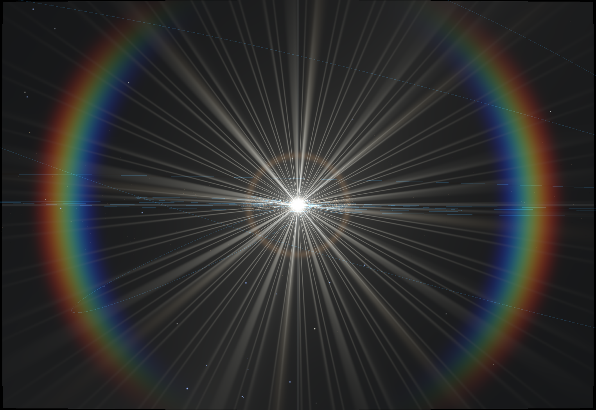
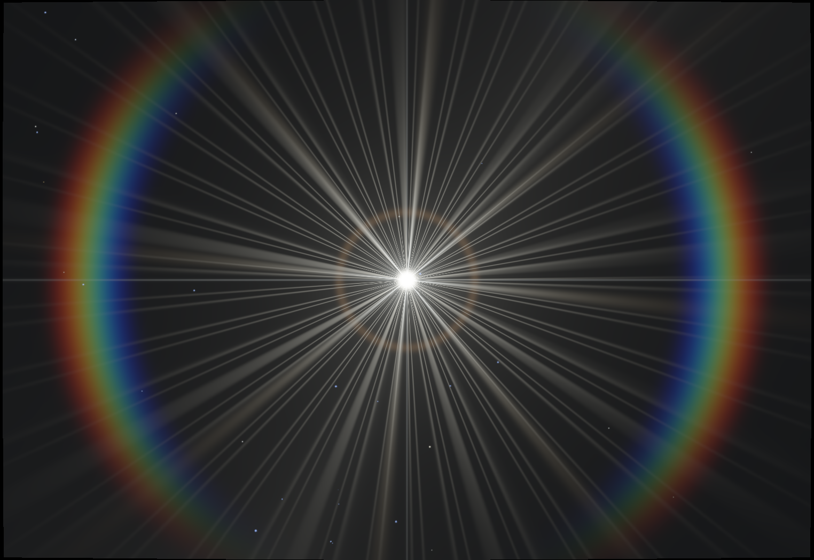

# Flares owned by the nearest system

The detector previously searched eight image tiles for bright eligible pixels. A single host hint could override one tile, but other tiles could still contribute unrelated catalogue stars. When the Sun became subpixel-sized, its host sampling could fail and a distant bright point would become the dominant flare.

There was a second contributor: the host's navigation marker and orbital guides were rendered into the scene being sampled. A three-pixel marker could cover the entire image of a tiny Sun, replacing its radiance and optical eligibility. Beyond the detailed-system drawing range, that marker disappeared, producing a different detection result again.

## Behaviour

- The live camera supplies an explicit list of emitters from the nearest stellar system. Changing selection or crossing the detailed-system rendering boundary does not transfer a flare to a brighter unrelated star.
- A resolved star is sampled around its own photosphere. A point-sized star is sampled at nearby pixel centres, avoiding loss from interpolated alpha. Both use actual composited scene radiance and its eligibility mask; the hint supplies position, not synthetic light.
- Every visible member has its own extraction slot. Two stars in the same old screen tile retain two optical centres, and a secondary member is no longer reduced to a negligible fraction of the primary's glare. The existing eight-source capacity accommodates the current multi-emitter systems.
- Off-screen or fully occulted stars do not acquire substitute flares from the background. A deliberately empty member list produces no optical sources.
- Accretion-flow highlights are searched only inside their projected emitting region. A core/companion group yields ownership if an unrelated catalogue system is spatially closer.
- Navigation markers, representative asteroid guide dots, orbit paths and selection reticles are composited additively after the optical scene. They preserve the active lens's geometric distortion without cutting dark lines through glare, erasing stellar light, entering exposure metering or appearing as opaque scene geometry in ocean reflections. The luminous star needs no artificial centre marker.

## Files and reasons

| File | Change |
| --- | --- |
| `CameraOptics.h/.cpp` | Add an explicit bounded emitter list; extract each member at its own projected location; retain independent secondary flares. Standalone image probes retain the generic extraction path. |
| `WindowManager.cpp` | Select optical ownership using system membership and spatial proximity, project all known members, and draw stellar-system overlays after optical processing on both fresh and reused frames. |
| `StarSystem.h/.cpp` | Separate navigation annotations from physical scene rendering and remove the redundant host marker. Apply the forward lens distortion to annotations so they stay aligned with the scene. |
| `LensCalibration.h` | Share the existing field-of-view calculation between the optical pass and annotation projection. |
| `dx12/Dx12SceneBridge.cpp` | Exclude the annotation pass from reconstruction jitter so guides remain aligned after DLAA/DLSS reconstruction. |
| `RenderChecks.cpp` | Sweep the Sun from the asteroid belt through the detailed/point transition; test off-screen rejection and two local emitters in one tile against a brighter unrelated background source. Test occultation and an empty source list. |

## Validation

The Release scene suites exercise the Sun at 2.5, 5, 50 and 10,000 AU plus both sides of the system detail boundary. Each visible Sun must yield exactly one source at its own projected centre. An off-screen Sun must yield none. A synthetic binary test requires two independent centres, one when a member is masked, and zero with an empty system list, while a brighter unrelated highlight remains visible elsewhere.

Both ordinary Release applications passed: **284 DX12 scene captures + 14 UI captures** and **275 OpenGL scene captures + 14 UI captures**, with zero failed assertions and zero DX12 validation errors. The Sun produced exactly one centred source at **2.5, 5, 50, 289.882, 295.738 and 10,000 AU**. Off-axis placement and nearest-system ownership independent of selection also passed. The same-tile binary test returned **2 / 1 / 0** sources for both-visible / one-masked / empty-system cases. The simulation/navigation suite passed its existing 38 quantum presets, hierarchy checks, two-million-star checks and seeded-streaming tests.

Both renderer variants are staged before promotion. Previous stable applications remain until the replacements pass their launch checks. PNG evidence is verified against raw captures before raw and superseded outputs are removed.

All **298 DX12** and **289 OpenGL** PNGs were checked against every raw framebuffer RGB pixel.

Both normal launchers passed **11 UI captures each** after promotion; those PNGs were likewise checked against their raw pixels. Promoted executable hashes match the validated Release candidates. Superseded application outputs and old captures were removed afterward. Raw/duplicate capture cleanup recovered **3,009.5 MiB**, including 62 duplicate PNGs; temporary import fixtures were removed separately. Both current renderer variants, incremental caches and useful text logs remain. Audit records use the `build/system-flares-*` prefix.

## Related nebula references

The user also supplied a [SpaceEngine dark-nebula post](https://www.reddit.com/r/spaceengine/comments/1kgc2in/first_time_i_discovered_a_dark_nebula_inside_it/) and [ESO's Barnard 68 image](https://www.eso.org/public/belgium-nl/images/eso9924a/). Reddit's title/discussion were accessible through search, but its images were unavailable during this work. ESO identifies B68 as a compact dark globule that obscures the background star field, roughly 500 ly away and 0.2 pc across. These are retained here as references for future nebula extinction/interior work; this change addresses flare ownership.
